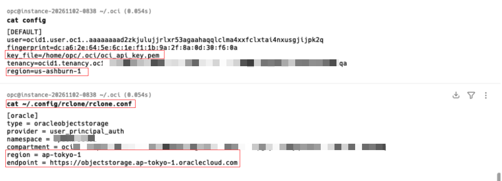

<div class="panel radius" markdown="1">
**Table of Contents**
{: #toc }
*  TOC
{:toc}
</div>

### 들어가며

이 글은 Oracle 공식 솔루션 플레이북 [Move data to object storage in the cloud by using Rclone](https://docs.oracle.com/en/solutions/move-data-to-cloud-storage-using-rclone/index.html)을 한글로 정리한 것입니다. 앞의 두 편에 이어, **Rclone을 실제로 설치하고 설정해서 데이터를 옮기고 검증하는 절차**를 처음부터 끝까지 따라갑니다.

> - 1편 [마이그레이션 도구 선택 가이드](): 상황별로 어떤 도구가 맞는지
> - 2편 [Rclone 활용](): Rclone 명령, 성능 옵션, 대량 파일 이전, OKE 활용

앱과 앱 데이터를 클라우드로 옮길 계획은 있지만, 여러 곳에 흩어진 비정형 데이터와 객체 데이터를 옮기는 일이 부담스러울 수 있습니다. Rclone을 쓰면 동영상, 백업, 로그 같은 대용량 비정형 데이터를 클라우드나 온프레미스에서 **OCI Object Storage**로 쉽게 옮길 수 있습니다.

원문은 다른 클라우드 제공자에서 Object Storage로 옮기는 방법을 중심으로, **OCI Object Storage Classic, Amazon S3, Microsoft Azure Blob Storage**(그리고 Google Cloud Storage)의 설정 예시를 다룹니다. 로컬 파일 시스템에서 옮기는 경우도 함께 설명합니다.

#### OCI Object Storage란

OCI Object Storage는 동영상, 백업, 로그 같은 대용량 비정형 데이터를 제한 없이 저장할 수 있는 서비스입니다. 저장된 데이터는 여러 장애 도메인(fault domain)에 자동으로 복제됩니다.

Object Storage를 쓰기 시작할 때 먼저 하는 일 중 하나가 기존 데이터를 옮기는 것입니다. 방법, 도구, 서비스는 여러 가지가 있고, 사용 사례와 데이터 양, 네트워크 대역폭에 따라 고르면 됩니다.

#### 시작 전에 확인할 점

이 솔루션은 시스템·네트워크 관리자, SRE, 솔루션 아키텍트, 엔지니어를 대상으로 합니다.

- **필요한 것**
  - Linux와 명령줄(CLI) 도구에 대한 기본 지식
  - `yum` 명령을 실행할 수 있는 관리자 권한
  - 유효한 Object Storage 자격 증명
- **전송 속도:** 네트워크 대역폭과 컴퓨팅 자원에 따라 다릅니다. 온프레미스에서 인터넷으로 OCI에 옮긴다면 FastConnect와 여러 대의 서버를 함께 고려하면 이전 시간을 줄일 수 있습니다.
- **다른 클라우드에서 옮길 때:** OCI Compute 인스턴스에서 실행하는 것이 좋습니다. 원문의 모든 예시는 `VM.DenseIO1.4` Compute 인스턴스에서 테스트했습니다.
- **비용:** 다른 클라우드에서 데이터를 받아오는 데 Oracle이 따로 받는 요금은 없습니다. Object Storage에 저장된 데이터는 표준 Object Storage 요금이 적용됩니다. 전송에 OCI Compute 인스턴스를 쓰면 그 사용료는 별도로 청구됩니다.

#### 전체 진행 단계

1. **Rclone 설치:** 시스템 전체 또는 한 사용자용으로 설치합니다.
2. **설정:** OCI Object Storage를 대상(remote)으로 설정하고, 원본 경로를 환경 변수로 지정합니다.
3. **전송과 검증:** 데이터를 옮기고 제대로 옮겨졌는지 확인합니다.

### 1단계: Rclone 설치

#### 시스템 전체에 설치

관리자 권한이 있으면 시스템 전체에 설치할 수 있습니다.

Oracle Linux 7에서는 `yum`으로 설치합니다.

```bash
//Oracle Linux 7
sudo yum install -y rclone //Oracle Linux 7
```

rclone은 현재 활성화된 *** Oracle Linux 9 *** 기본 저장소(BaseOS, AppStream, Addons, UEK 등)에 없습니다. 따라서 아래와 같이 설치 해야합니다.
```bash
//Oracle Linux 9
sudo dnf install -y https://downloads.rclone.org/rclone-current-linux-amd64.rpm
rclone version
```

다른 Linux 배포판에서는 Rclone이 제공하는 설치 스크립트로 최신 버전을 설치합니다.

```bash
curl https://rclone.org/install.sh | sudo bash
```

#### 한 사용자용으로 설치

관리자 권한이 없거나 시스템 전체에 설치하고 싶지 않으면, 최신 바이너리를 내려받아 바로 쓸 수 있습니다. 아래 명령은 Rclone을 내려받고, 홈 폴더에 `bin` 디렉터리를 만들어 `PATH` 환경 변수에 추가합니다.

```bash
mkdir ~/Temp
cd ~/Temp/
curl -O https://downloads.rclone.org/rclone-current-linux-amd64.zip
unzip rclone-current-linux-amd64.zip
cd rclone-*-linux-amd64
mkdir ~/bin
cp rclone ~/bin/
export PATH=$PATH:~/bin
echo 'export PATH=$PATH:~/bin' >> ~/.bashrc # 선택: 로그인할 때마다 PATH에 추가하려는 경우만
```

> **참고:** `.bashrc`에 넣지 않으면 로그아웃할 때 `PATH` 설정이 초기화됩니다.

### 2단계: OCI Object Storage 대상 설정

Rclone은 OCI Object Storage 기본(native) API로 데이터를 버킷에 옮길 수 있습니다. 데이터를 넣을 대상 버킷을 미리 정해 둡니다. 버킷을 만드는 방법은 원문의 Explore More에 있는 "Put data into object storage" 튜토리얼을 참고합니다.

원문은 Linux 호스트에서 **OCI 사용자 + API 키** 방식으로 인증합니다. 다른 인증 방식은 [rclone Oracle Object Storage 문서](https://rclone.org/oracleobjectstorage/)를 참고합니다.

***참고 OCI CLI와 Object Storage 설정 참고***

***아래 화면을 보시면 CLI config의 경우는 오라클 클라우드의 home 리전으로 설정하며, rclone config의 경우에는 Object Storage를 사용하는 리전의 값으로 설정되어 있어야합니다. 해당 부분을 햇깔리기 쉬우므로 참고 하시기 바랍니다.***



#### 2-1. 인증 정보와 버킷 정보 준비

API 서명 키 쌍을 만들고 config 파일을 설정한 뒤, 테넌시 namespace, compartment, 리전 정보를 확인합니다.

**① API 서명 키 쌍 만들기**

1. 사용자 상세 화면으로 이동합니다.
   - 내 API 키를 만든다면: **Profile** 메뉴(사용자 메뉴 아이콘) → **User Settings**
   - 관리자가 다른 사용자의 키를 만든다면: 콘솔에서 **Identity** → **Users** → 목록에서 사용자 이름 클릭
2. 왼쪽 **Resources** 영역에서 **API Keys**를 클릭합니다.
3. **Add API Key**를 클릭합니다.
4. API Keys 목록 왼쪽 위의 **Add API Key**를 클릭하면 **Add API Key** 대화 상자가 열립니다.
5. **Download Private Key**를 클릭해 개인 키를 `.oci` 디렉터리에 저장합니다. 대부분은 공개 키를 내려받을 필요가 없습니다.
   - `.oci` 디렉터리가 없으면 홈 디렉터리에 만듭니다.
   - 브라우저가 다른 폴더에 내려받았다면 `.oci` 디렉터리로 옮깁니다.
6. **Add**를 클릭합니다.
   - 키가 사용자에게 추가되고 **Configuration File Preview**가 나타납니다. 프로필 이름이 `DEFAULT`로 표시되는데, 이 이름은 나중에 Rclone을 설정할 때 필요합니다.
   - 미리보기의 설정 내용을 복사해 `.oci` 디렉터리의 `config` 파일에 붙여 넣습니다.
   - config 파일의 `key_file` 경로를 5번에서 저장한 개인 키 위치로 고칩니다.
   - 이 config 파일의 경로를 기록해 둡니다. Rclone 설정에 씁니다.

**② Object Storage namespace 확인**

1. **Profile** 메뉴 → **Tenancy: <테넌시 이름>**을 클릭합니다. **Object Storage Settings** 아래에 namespace 문자열이 있습니다.
2. namespace 문자열을 복사해 둡니다.

**③ 버킷의 compartment와 리전 확인**

1. OCI 콘솔에서 **Storage** → **Object Storage & Archive Storage** → **Buckets**로 이동해, 데이터를 옮길 버킷을 찾습니다.
2. 버킷 이름을 클릭해 상세 화면을 엽니다.
3. 콘솔 화면 왼쪽 위에서 버킷이 있는 리전과 리전 이름을 확인해 둡니다.
4. **Compartment** 옆의 이름 링크를 클릭해 compartment 상세 화면을 엽니다.
5. **Compartment Information** 탭에서 compartment OCID를 복사해 둡니다.

#### 2-2. `rclone config`로 remote 만들기

1. Linux 시스템에서 `rclone config`를 실행해 대화형 설정을 시작합니다.

   ```text
   $ rclone config
   No remotes found, make a new one?
   e) Edit existing remote
   n) New remote
   d) Delete remote
   r) Rename remote
   c) Copy remote
   s) Set configuration password
   q) Quit config
   e/n/d/r/c/s/q>
   ```

2. `n) New remote`를 고르고, 새 remote의 이름을 입력합니다.

   ```text
   Enter name for new remote.
   <enter your name here>
   ```

3. 스토리지 유형 목록에서 **Oracle Cloud Infrastructure Object Storage (`oracleobjectstorage`)** 번호를 고릅니다.

   ```text
   Option Storage.
   Type of storage to configure.
   Choose a number from below, or type in your own value.
   .
   .
   .
   45 / Oracle Cloud Infrastructure Object Storage
      \ (oracleobjectstorage)
   
   <snip>
   Storage> 45
   ```

   > **주의:** 원문 작성 시점에는 36번이었지만, Rclone 버전이 올라가면서 스토리지 종류가 추가되면 번호가 바뀝니다. 반드시 OCI Object Storage 항목인지 확인하고 고릅니다.

4. 인증 방식(Auth Provider)을 고릅니다. 이 예시에서는 `2` (**OCI user and API Key**, `user_principal_auth`)를 고릅니다.

   ```text
   Option provider.
   Choose your Auth Provider
   Choose a number from below, or type in your own string value.
   Press Enter for the default (env_auth).
    1 / automatically pickup the credentials from runtime(env), first one to provide auth wins
      \ (env_auth)
      / use an OCI user and an API key for authentication.
    2 | you'll need to put in a config file your tenancy OCID, user OCID, region, the path, fingerprint to an API key.
      | https://docs.oracle.com/en-us/iaas/Content/API/Concepts/sdkconfig.htm
      \ (user_principal_auth)
      / use instance principals to authorize an instance to make API calls.
    3 | each instance has its own identity, and authenticates using the certificates that are read from instance metadata.
      | https://docs.oracle.com/en-us/iaas/Content/Identity/Tasks/callingservicesfrominstances.htm
      \ (instance_principal_auth)
      / use workload identity to grant OCI Container Engine for Kubernetes workloads policy-driven access to OCI resources using OCI Identity and Access Management (IAM).
    4 | https://docs.oracle.com/en-us/iaas/Content/ContEng/Tasks/contenggrantingworkloadaccesstoresources.htm
      \ (workload_identity_auth)
    5 / use resource principals to make API calls
      \ (resource_principal_auth)
    6 / no credentials needed, this is typically for reading public buckets
      \ (no_auth)
   provider> 2
   ```

5. 2-1의 ②에서 확인한 **namespace**를 입력합니다.

   ```text
   Option namespace.
   Object storage namespace
   Enter a value.
   namespace> namespace_name
   ```

6. 2-1의 ③에서 확인한 버킷의 **compartment OCID**를 입력합니다.

   ```text
   Option compartment.
   Object storage compartment OCID
   Enter a value.
   compartment> ocid1.compartment.oc1xxx.xxxx.xxxx.xxxx
   ```

7. 2-1의 ③에서 확인한 버킷의 **리전**을 입력합니다.

   ```text
   Option region.
   Object storage Region
   Enter a value.
   region> us-ashburn-1
   ```

8. endpoint는 비워 둡니다. 비워 두면 리전의 기본 endpoint를 쓰고, Rclone이 앞에서 입력한 정보로 전체 endpoint URL을 만듭니다.

   ```text
   Option endpoint.
   Endpoint for Object storage API.
   Leave blank to use the default endpoint for the region.
   Enter a value. Press Enter to leave empty.
   endpoint>
   ```

9. 2-1의 ①에서 만든 **OCI config 파일 전체 경로**와 **프로필 이름**을 입력하고, 고급 설정(advanced config)은 `n`으로 넘어갑니다.

   ```text
   Option config_file.
   Path to OCI config file
   Choose a number from below, or type in your own string value.
   Press Enter for the default (~/.oci/config).
    1 / oci configuration file location
      \ (~/.oci/config)
   config_file> /home/username/.oci/config
   Option config_profile.
   Profile name inside the oci config file
   Choose a number from below, or type in your own string value.
   Press Enter for the default (Default).
    1 / Use the default profile
      \ (Default)
   config_profile> DEFAULT
   Edit advanced config?
   y) Yes
   n) No (default)
   y/n> n
   ```

10. 설정 요약을 확인하고, 맞으면 `y`로 저장합니다.

    ```text
    Options:
    - type: oracleobjectstorage
    - provider: user_principal_auth
    - namespace: namespace
    - compartment: ocid1.compartment.oc1xxx.xxxx.xxxx.xxxx
    - region: us-ashburn-1
    - config_file: /home/username/.oci/config
    - config_profile: DEFAULT
    Keep this "foo" remote?
    y) Yes this is OK (default)
    e) Edit this remote
    d) Delete this remote
    y/e/d> y
    Current remotes:
    Name                 Type
    ====                 ====
    remote_name          oracleobjectstorage
    ```

11. `q`로 설정 화면을 나옵니다.

    ```text
    e) Edit existing remote
    n) New remote
    d) Delete remote
    r) Rename remote
    c) Copy remote
    s) Set configuration password
    q) Quit config
    e/n/d/r/c/s/q> q
    ```

12. compartment의 버킷 목록을 조회해서 연결을 확인합니다.

    ```text
    $ rclone lsd remote_name:
              -1 2024-04-19 00:08:33        -1 bucket1
    ```

> 2편에서 본 설정 파일 예시(`[oci]`, `type = oracleobjectstorage` …)가 바로 이 과정을 거쳐 만들어지는 remote 설정입니다. 3단계의 명령은 이 remote 이름을 `oci`로 만들었다고 가정합니다.

### 3단계: 원본(Source) 설정

Rclone의 원본은 로컬 파일 시스템일 수도, 다른 클라우드 제공자일 수도 있습니다. 아래는 로컬 파일 시스템과 자주 쓰는 클라우드 제공자의 설정 예시입니다. 모든 경우에 원본 경로를 `SOURCE` 환경 변수로 지정해 두고, 4단계에서 이 변수를 씁니다.

> **참고:** 이 목록이 전부는 아닙니다. Rclone이 지원하는 다른 제공자도 설정할 수 있습니다. 지원 제공자 전체 목록과 설정 항목은 [Rclone 웹사이트](https://rclone.org/)를 참고합니다.

#### 로컬 파일 시스템

따로 설정할 것은 없습니다. 원본으로 쓸 로컬 디렉터리 경로를 환경 변수로 지정하면 됩니다.

```bash
export SOURCE=/path/to/source
```

#### OCI Object Storage Classic

사용자 이름, 비밀번호, 서비스 인스턴스 ID, 인증 URL이 필요합니다.

> **참고:** Object Storage Classic 같은 Swift 호환 원본을 쓰려면 Rclone 1.4 이상이 필요합니다.

1. 인증 URL을 확인합니다.
   1. Oracle Cloud **My Services**에 로그인합니다.
   2. **Oracle Cloud Infrastructure Object Storage Classic**을 찾습니다.
   3. **Actions** 메뉴에서 **View Details**를 고릅니다. (또는 Dashboard 페이지의 Oracle Cloud Infrastructure Object Storage Classic 링크를 클릭합니다.)
   4. 계정을 만든 시기에 따라 인증 URL을 확인합니다.
      - **2017년 4월 이후에 만든 계정:** **Additional Information** 영역의 **Auth V1 Endpoint** 값이 인증 URL입니다. 예: `https://foo.storage.oraclecloud.com/auth/v1.0`
      - **2017년 4월 이전에 만든 계정:** 인증 URL을 직접 만들어야 합니다.
        1. **Additional Information** 영역의 **REST Endpoint** 값을 확인합니다. 예: `https://foo.storage.oraclecloud.com/v1/myservice-bar`
        2. 이 URL에서 `v1/myservice-bar` 부분을 지웁니다. → `https://foo.storage.oraclecloud.com/`
        3. 끝에 `auth/v1.0`을 붙입니다. → `https://foo.storage.oraclecloud.com/auth/v1.0`
2. REST endpoint URL에서 서비스 인스턴스 ID를 찾습니다. 예를 들어 REST API endpoint URL이 `https://foo.storage.oraclecloud.com/v1/myservice-bar`라면 서비스 인스턴스 ID는 `myservice-bar`입니다.
3. 환경 변수로 Rclone을 설정합니다. `your_...` 부분은 자신의 값으로 바꿉니다.

   ```bash
   export RCLONE_CONFIG_OCIC_TYPE=swift
   export RCLONE_CONFIG_OCIC_USER=your_service_instance_ID:your_username
   export RCLONE_CONFIG_OCIC_KEY=your_password
   export RCLONE_CONFIG_OCIC_AUTH=your_authentication_URL
   export SOURCE=ocic:your_source_container
   ```

   마지막 줄 `export SOURCE=ocic:<원본 컨테이너>`가 원본을 OCI-C로 지정합니다.

#### Amazon S3

액세스 키, 시크릿 키, (필요하면) 버킷 리전이 필요합니다. 준비되면 명령줄에서 환경 변수로 설정합니다. `your_...` 부분은 자신의 값으로 바꿉니다.

```bash
export RCLONE_CONFIG_S3_TYPE=s3
export RCLONE_CONFIG_S3_ACCESS_KEY_ID=your_access_key
export RCLONE_CONFIG_S3_SECRET_ACCESS_KEY=your_secret_key
export RCLONE_CONFIG_S3_REGION=region_of_your_bucket
export SOURCE=s3:your_source_bucket
```

마지막 줄 `export SOURCE=s3:your_source_bucket`이 원본을 S3로 지정합니다.

> 2편에서 설명한 것처럼, AWS에서 KMS 서버 측 암호화를 쓰고 있으면 checksum 오류를 피하도록 `server_side_encryption = aws:kms` 설정이 필요합니다. ([Rclone S3 KMS](https://rclone.org/s3/#key-management-system-kms))

#### Microsoft Azure Blob Storage

스토리지 계정 이름과 키가 필요합니다. 준비되면 환경 변수로 설정합니다. `your_...` 부분은 자신의 값으로 바꿉니다.

```bash
export RCLONE_CONFIG_AZURE_TYPE=azureblob
export RCLONE_CONFIG_AZURE_ACCOUNT=your_storage_account_name
export RCLONE_CONFIG_AZURE_KEY=your_key
export SOURCE=azure:your_source_bucket
```

마지막 줄 `export SOURCE=azure:your_source_bucket`이 원본을 Azure로 지정합니다.

#### Google Cloud Storage

ADC(Application Default Credentials)로 Rclone에 Google Cloud Storage를 설정합니다. 자세한 내용은 원문 Explore More의 "Set up Application Default Credentials"를 참고합니다.

1. Google Cloud CLI를 설치하고 초기화합니다.

   ```bash
   gcloud init
   ```

2. 사용자 계정의 로컬 인증 정보를 만듭니다.

   ```bash
   gcloud auth application-default login
   ```

   - 인증 파일은 `$HOME/.config/gcloud/application_default_credentials.json`에 만들어집니다.
   - 이 파일에서 `client_id`, `client_secret`, `quota_project_id` 값을 확인합니다.

3. `application_default_credentials.json`에서 확인한 값으로 환경 변수를 설정합니다. 아래는 원문 예시를 그대로 옮긴 것입니다.

   ```bash
   export RCLONE_CONFIG_TARGETS3_TYPE=gcs
   export RCLONE_CONFIG_TARGETS3_PROJECT_NUMBER=your quota_project_id
   export RCLONE_CONFIG_TARGETS3_CLIENT_ID=your client_id
   export RCLONE_CONFIG_TARGETS3_CLIENT_SECRET=your client_secret
   export RCLONE SOURCE=gcp:your_source_bucket
   ```

> **확인 필요:** 원문 예시는 remote 이름 표기가 일치하지 않습니다. 환경 변수는 `TARGETS3`라는 이름의 remote를 정의하는데, 마지막 줄은 `gcp:` remote를 원본으로 가리키고 `export RCLONE SOURCE=`처럼 띄어쓰기가 들어가 있습니다. Rclone은 `RCLONE_CONFIG_<이름>_...` 환경 변수의 `<이름>`을 remote 이름으로 씁니다([rclone 문서: Config file 환경 변수](https://rclone.org/docs/#config-file)). 그래서 다른 원본 예시와 같은 형식으로 쓰려면 remote 이름과 `SOURCE` 값을 서로 맞춰야 합니다. 실제 적용 전에 `rclone lsd <remote 이름>:`으로 원본이 조회되는지 먼저 확인하세요.

### 4단계: 데이터 전송

설정이 끝나면 전송을 시작합니다. 데이터 양과 연결 속도에 따라 전송은 **며칠에서 몇 주**가 걸릴 수도 있습니다. 진행 상황을 보려면 **tmux 안에서 verbose 모드로** 시작하는 것을 권장합니다. 그러면 프로세스를 백그라운드에서 돌리면서 필요할 때마다 진행 상황을 확인할 수 있습니다.

1. tmux 세션을 이름을 붙여 시작합니다.

   ```bash
   tmux new -s session_name
   ```

   예:

   ```bash
   tmux new -srclone
   ```

2. tmux 터미널 창에서 Rclone을 verbose 모드로 시작합니다. `destination_bucket`은 대상 버킷 이름으로 바꿉니다. (원문에 따르면 버킷이 없으면 자동으로 만들어집니다.)

   ```bash
   rclone --verbose --cache-workers 64 --transfers 64 --retries 32 copy $SOURCE oci:destination_bucket
   ```

3. 전송이 진행되는 동안 `Ctrl+b` `d`를 눌러 tmux에서 빠져나옵니다(detach).
4. Rclone 진행 상황을 다시 보려면 tmux 세션에 다시 붙습니다.

   ```bash
   tmux attach -d -t session_name
   ```

   예:

   ```bash
   tmux attach -d -t rclone
   ```

5. 다시 빠져나오려면 `Ctrl+b` `d`를 누릅니다.

> **참고:** 알맞은 cache-workers 수와 transfers 수는 사용 사례, 사용할 수 있는 대역폭, 작업 서버의 자원, 클라우드 제공자의 throttling 제한에 따라 다릅니다. 보통 값이 클수록 빨리 끝나지만, 어느 수준을 넘으면 오류가 나기 시작할 수 있습니다. **동시 전송 64, cache-workers 64로 시작해 필요에 따라 조정**하는 것을 권장합니다.
>
> 전송이 끝나면 오류가 없었는지 확인합니다. 오류가 있으면 cache-workers와 transfers 수를 줄여서 다시 실행합니다.

> transfers, checkers 같은 성능 옵션을 더 세밀하게 고르는 방법은 2편의 [성능에 영향을 주는 주요 옵션](#성능에-영향을-주는-주요-옵션)을 참고하세요.

### 5단계: 전송 검증

데이터를 어떤 방법으로 옮겼든(로컬 파일 시스템이든, 다른 클라우드든, 다른 수단이든) Rclone으로 Object Storage에 복사된 데이터가 원본과 같은지 확인할 수 있습니다. 빠르게 확인하는 방법과 꼼꼼하게 확인하는 방법이 있습니다.

#### 빠른 검증

```bash
rclone --verbose --cache-workers 64 --transfers 64 --retries 32 check $SOURCE oci:destination_bucket
```

파일 크기와 MD5 해시를 비교해서 원본과 대상의 차이를 찾습니다. 하지만 **multipart로 업로드한 객체에는 MD5 해시를 쓸 수 없습니다.** 그래서 큰 객체는 파일 크기만 비교하게 되고, 이는 간단한 확인 수준에 그칩니다.

#### 꼼꼼한 검증

Rclone이 파일을 내려받아서 비교하게 합니다.

```bash
rclone --verbose --cache-workers 64 --transfers 64 --retries 32 check --download $SOURCE oci:destination_bucket
```

더 꼼꼼하게 비교하지만, 양쪽 스토리지에서 사본을 모두 내려받아야 합니다.

> **주의:** 다운로드 검증을 하면 작업을 어디서 실행하느냐에 따라 기존 클라우드 제공자, Oracle, 또는 양쪽 모두에서 **데이터 전송 요금이 추가로 발생**할 수 있습니다.

### 다음 단계

- 1편: [OCI 클라우드 스토리지로 데이터 이전하기: 마이그레이션 도구 선택 가이드]()
- 2편: [OCI 클라우드 스토리지로 데이터 이전하기 (2편): Rclone 활용]()
- OCI Object Storage Sync, s5cmd: [Tutorial 3: Move Data into OCI Cloud Storage Services using OCI Object Storage Sync and S5cmd](https://docs.oracle.com/en/learn/migr-ocistorage-ossync-s5cmd-p3)
- fpsync, rsync (파일 시스템 이전): [Tutorial 4: Move Data into OCI Cloud Storage Services using Fpsync and Rsync for File System Data Migrations](https://docs.oracle.com/en/learn/migr-ocistorage-fpsync-rsync-p4)

### 마무리

Rclone으로 OCI Object Storage에 데이터를 옮기는 기본 흐름은 **설치 → 대상(OCI) remote 설정 → 원본을 `SOURCE` 환경 변수로 지정 → tmux에서 `copy` → `check`로 검증**입니다. 대상 설정에는 API 키, config 파일, namespace, compartment OCID, 리전이 필요하니 미리 준비해 둡니다. 검증할 때는 multipart로 올린 큰 객체는 크기만 비교된다는 점을 기억하고, 필요하면 비용을 감안해 `--download` 검증을 고려합니다.

#### 참고자료

* [Oracle: Move data to object storage in the cloud by using Rclone](https://docs.oracle.com/en/solutions/move-data-to-cloud-storage-using-rclone/index.html)
  * [Install Rclone](https://docs.oracle.com/en/solutions/move-data-to-cloud-storage-using-rclone/install-rclone1.html)
  * [Configure Rclone for Object Storage](https://docs.oracle.com/en/solutions/move-data-to-cloud-storage-using-rclone/configure-rclone-object-storage.html)
  * [Configure Your Source](https://docs.oracle.com/en/solutions/move-data-to-cloud-storage-using-rclone/configure-your-source1.html)
  * [Move Your Data to Oracle Cloud Infrastructure](https://docs.oracle.com/en/solutions/move-data-to-cloud-storage-using-rclone/move-your-data-oci.html)
  * [Explore More](https://docs.oracle.com/en/solutions/move-data-to-cloud-storage-using-rclone/explore-more.html)
* [Oracle: Move Data into OCI Cloud Storage Services using Rclone](https://docs.oracle.com/en/learn/migr-ocistorage-rclone-p2/index.html)
* [rclone: Oracle Object Storage](https://rclone.org/oracleobjectstorage/)
