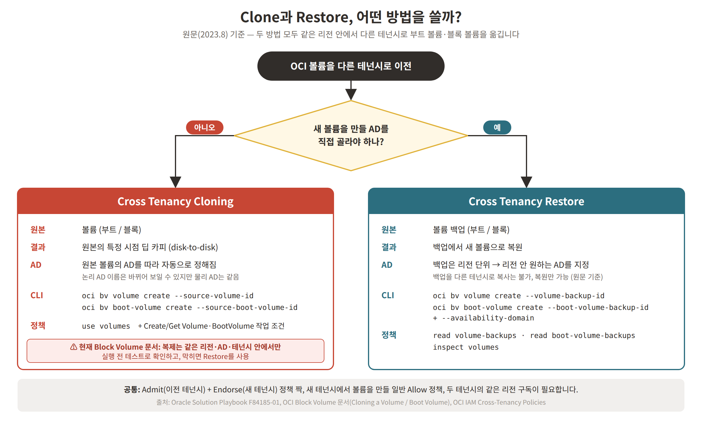
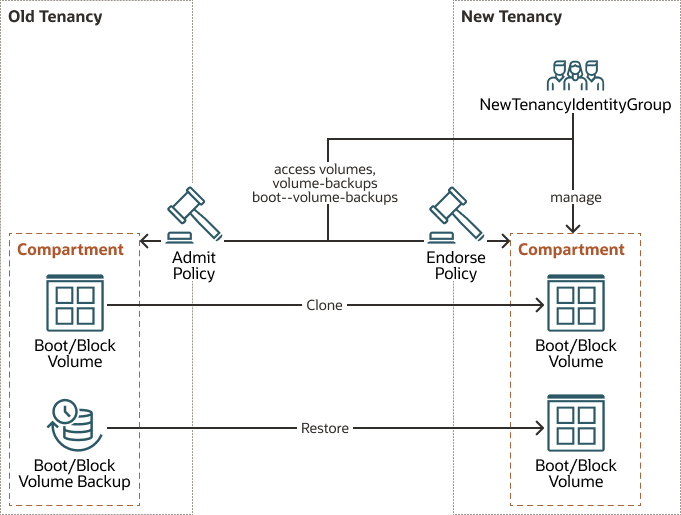
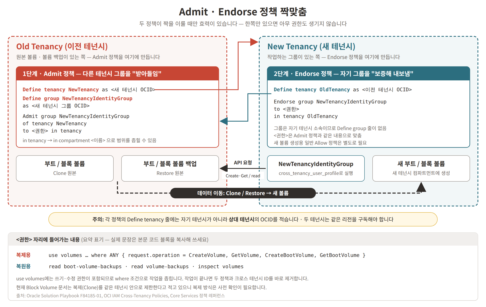
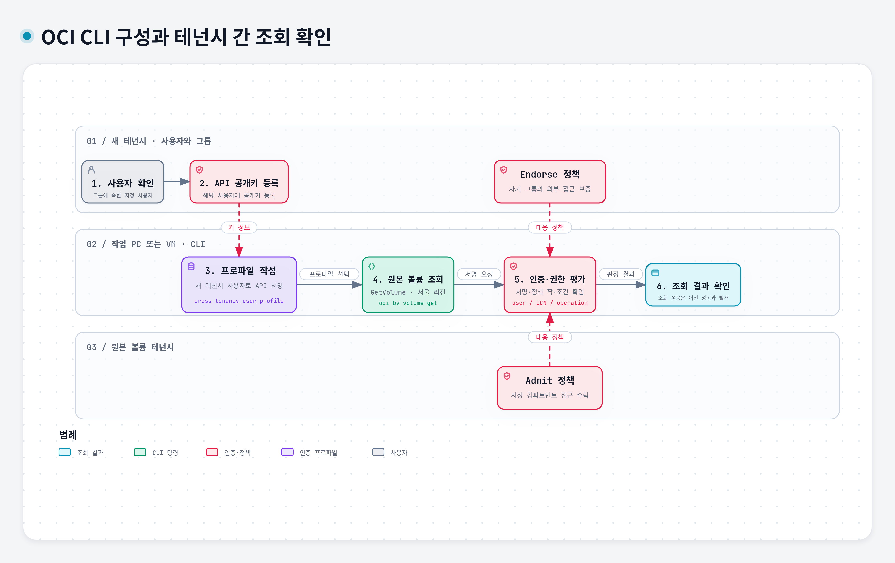
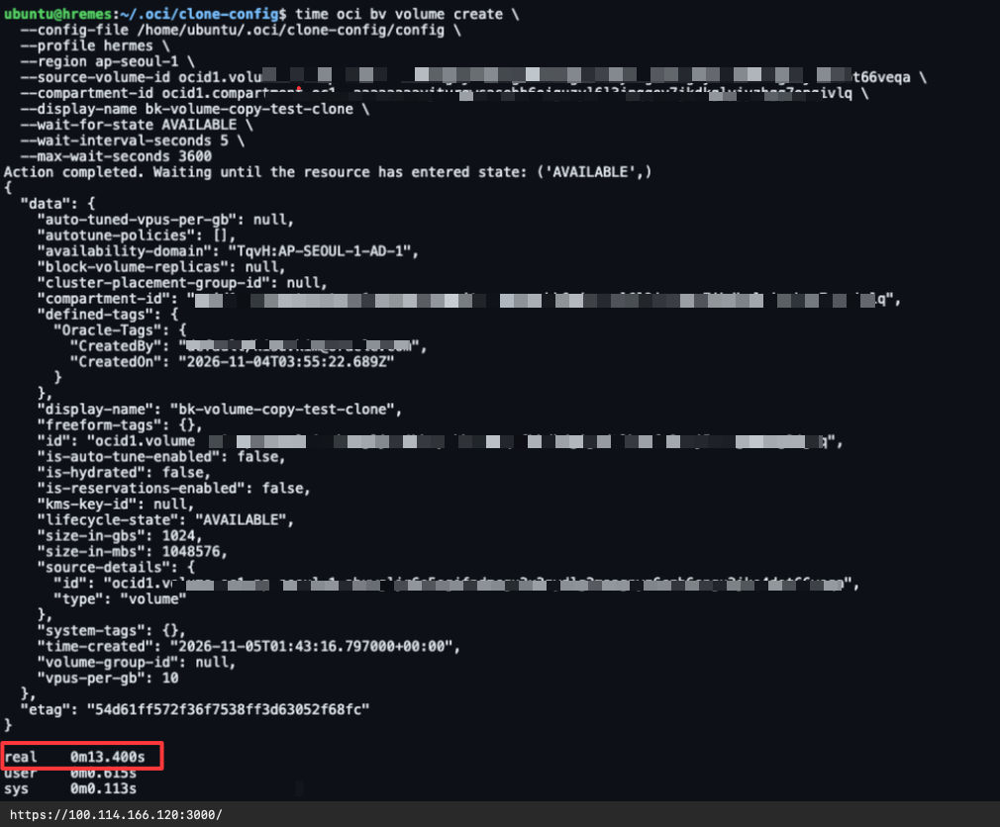
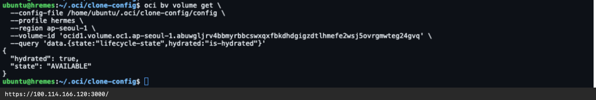

<div class="panel radius" markdown="1">
**Table of Contents**
{: #toc }
*  TOC
{:toc}
</div>

### 들어가며

Oracle 원문은 테넌시 간 볼륨 데이터 이전을 짧은 다운타임으로 수행하는 방법을 소개합니다. 이 글에서는 실제 OCI 환경에서 이전을 실행하지 않았으므로 중단 시간과 애플리케이션 데이터 정합성을 검증하지 않았습니다.

이 글은 Oracle Solution Playbook [Migrate Oracle Cloud Infrastructure volume data across tenancies](https://docs.oracle.com/en/solutions/migrate-data-across-tenancies/index.html)를 한글로 정리한 것입니다. OCI 볼륨(부트 볼륨, 블록 볼륨)에 저장된 데이터를 다른 OCI 테넌시로 옮기는 방법을 다루며, 다음과 같은 경우에 도움이 됩니다.

- 여러 고객 테넌시 사이에서 데이터를 옮길 때
- 서비스 제공자 변경 같은 운영·비즈니스상의 이유로 새 테넌시로 데이터를 옮길 때
- 랜섬웨어 공격에 대비할 때

> **먼저 확인하세요 (2026년 11월 기준):** 원문은 2023년 8월판입니다. 현재 OCI Block Volume 문서는 복제(Clone)를 **같은 리전, 같은 AD, 같은 테넌시** 안에서만 만들 수 있다고 적고 있습니다. "You can create a clone for a volume only within the same region, availability domain and tenancy." ([Cloning a Volume](https://docs.oracle.com/en-us/iaas/Content/Block/Tasks/cloningavolume.htm)), "You can only create a clone for a boot volume within the same region, availability domain, and tenant." ([Cloning a Boot Volume](https://docs.oracle.com/en-us/iaas/Content/Block/Tasks/cloningabootvolume.htm)). 따라서 이 글의 **Cross Tenancy Cloning** 절차는 현재 그대로 동작하지 않을 수 있습니다. 이 충돌만으로 기능 폐지 여부를 단정할 수는 없습니다. **작성자가 제공한 2026년 11월 4일 실행 결과에서는 서울 리전의 서로 다른 테넌시 간 블록 볼륨 Clone 생성 요청이 성공**했습니다. 추가로 제공된 11월 5일 테스트에서는 300GiB 파일 3개를 준비한 조건에서 `AVAILABLE` 확인까지 `real 0m13.400s`가 기록됐습니다. 해당 시간 측정 응답은 `is-hydrated=false`였습니다. 별도로 제공된 추가 조회 화면에서는 `hydrated=true`, `AVAILABLE`이 확인됐으며, 두 화면의 동일 볼륨 여부와 hydration 소요 시간은 미확인입니다. 데이터 정합성·부트 볼륨·다른 리전은 확인하지 않았습니다. 자세한 내용은 아래 테스트 케이스를 참고하고, 다른 환경의 적용 가능 여부는 별도로 확인해야 합니다. **Cross Tenancy Restore**도 권한과 적용 조건을 별도로 확인해야 하며, 이 글에서 실행 성공을 검증한 것은 아닙니다.

### 이전 방법 이해하기

2023년 Playbook은 부트 볼륨과 블록 볼륨의 테넌시 간 이전 방법을 다음 두 가지로 소개합니다. 아래 비교는 원문 기준이며 현재 지원 여부를 보장하지 않습니다.

| 방법 | 쓰임새 | 원본 |
|---|---|---|
| **Cross Tenancy Cloning** | 같은 가용성 도메인(AD) 안에서 이전 (현재 문서와 충돌, 위 주의 참고) | 볼륨 |
| **Cross Tenancy Restore** | AD를 넘어서 이전 (같은 리전) | 볼륨 백업 |

원문은 두 방법을 짧은 다운타임의 이전 방법으로 소개합니다. 실제 중단 시간은 이 글에서 검증하지 않았습니다. 아래 그림은 원문의 방법 선택 기준을 요약한 것이며, 지원 여부 및 권한 검증을 대신하지 않습니다.



*원문 내용을 바탕으로 이 글에서 정리한 그림입니다. 그림의 “막히면 Restore를 사용”은 성공을 보장하는 안내가 아닙니다. Restore도 별도 권한·적용 조건 확인과 테스트가 필요합니다.*

#### Cross Tenancy Cloning

2023년 Playbook은 한 테넌시의 부트 볼륨과 데이터 볼륨을 다른 테넌시로 복제하는 방법을 설명합니다. 테넌시 간 Clone의 현재 지원 여부는 미확인입니다. 원문에서 복제된 볼륨은 원본 볼륨의 특정 시점을 디스크에서 디스크로 바로 떠낸 **딥 카피(point-in-time deep copy)**입니다.

- OCI 볼륨은 **AD 단위 리소스**입니다. 복제하면 새 볼륨의 AD는 원본 볼륨의 AD를 따라 자동으로 정해집니다.
- OCI는 고객에게 **논리 AD**만 보여 줍니다. 논리 AD와 실제 물리 AD의 매핑은 테넌시마다 정해지며 테넌시마다 다를 수 있습니다. 그래서 이전 테넌시에서 AD1에 있던 볼륨이, 복제 후 새 테넌시에서는 AD3에 있는 것으로 보일 수 있습니다. AD가 바뀐 것처럼 보이지만, 실제로는 같은 물리 AD에 있습니다.
- 같은 리전의 **특정 AD**로 옮기고 싶다면 복제 대신 Cross Tenancy Restore를 씁니다.
- **주의:** 현재 Block Volume 문서는 복제를 같은 테넌시 안으로 제한한다고 적고 있습니다(글 앞부분 참고). 이 섹션은 원문(2023년 8월) 기준 설명입니다.

#### Cross Tenancy Restore

OCI 볼륨 백업을 다른 테넌시에 복원해서 AD를 넘어 이전합니다.

- OCI 볼륨 백업은 **리전 단위**라서, 리전 안의 모든 AD에서 복원할 수 있습니다. 같은 리전 안에서 AD를 바꿔 이전하려면 복제보다 이 방법이 맞습니다.
- 원문 기준(2023년 8월)으로는 **백업을 다른 테넌시로 복사할 수는 없고**, 같은 리전의 다른 테넌시로 **복원만** 할 수 있습니다. 현재 문서에서도 백업 복사는 리전 간 복사만 안내되어 있습니다.

### 필요한 권한 이해하기

이 작업에 필요한 권한은 OCI IAM 정책으로 엄격하게 통제됩니다.

- **Admit 정책**은 **이전 테넌시(Old Tenancy)**에 정의합니다.
- 짝이 되는 **Endorse 정책**은 **새 테넌시(New Tenancy)**에 정의합니다.

두 정책이 모두 있어야 사용자가 테넌시를 넘나드는 작업을 실행할 수 있습니다. OCI IAM 문서도 "짝이 되는 문장이 없으면 Endorse나 Admit 문장 하나만으로는 아무 권한도 생기지 않으며, 두 테넌시가 모두 동의해야 한다"고 설명합니다("Without a corresponding statement that specifies access, a particular Endorse or Admit statement grants no access. Both tenancies must agree on access.", [Cross-Tenancy Policies](https://docs.oracle.com/en-us/iaas/Content/Identity/policieshow/iam-cross-domain.htm)).

원문에는 없지만 OCI 문서 기준으로 다음 조건도 함께 확인해야 합니다.

- **같은 리전 구독:** 정책과 별개로, 두 테넌시가 **같은 리전을 구독**하고 있어야 리소스를 공유할 수 있습니다("target and source tenancies must subscribe to the same regions to share resources", [Cross-Tenancy Policies](https://docs.oracle.com/en-us/iaas/Content/Identity/policieshow/iam-cross-domain.htm)).
- **새 테넌시의 일반 정책:** 볼륨은 새 테넌시 컴파트먼트에 만들어집니다. Core Services 정책 레퍼런스에서 `CreateVolume`은 `VOLUME_CREATE`(`manage volumes` 수준) 권한이 필요하고, 백업에서 만들 때는 `VOLUME_BACKUP_READ`도 필요합니다. 부트 볼륨 백업 복원에는 `read boot-volume-backups`의 `BOOT_VOLUME_BACKUP_READ` 권한과 대상 볼륨 생성 권한도 확인해야 합니다. `NewTenancyIdentityGroup`에는 대상 컴파트먼트의 볼륨 생성 권한을 부여하는 일반 Allow 정책이 필요하며, 원본 백업 접근 권한은 Admit·Endorse 정책으로 별도로 확인해야 합니다([Details for the Core Services](https://docs.oracle.com/en-us/iaas/Content/Identity/Reference/corepolicyreference.htm)).

원문은 다음 보안 원칙을 함께 강조합니다.

- 다른 테넌시 사용자를 위한 크로스 테넌시 ID(identity)는 **필요할 때만**, 매우 신중하게 구성합니다. 작업이 끝나면 **즉시 제거**합니다.
- 크로스 테넌시 작업에 **꼭 필요한 권한만** 부여합니다.
- 크로스 테넌시 사용자에게 **쓰기(write), 수정(update), 삭제(delete) 권한은 절대 주지 않습니다.** 들어오는 모든 요청에 IAM 정책 조건(condition)을 겁니다. 쓸 수 있는 조건은 [General Variables for All Requests](https://docs.oracle.com/en-us/iaas/Content/Identity/policyreference/policyreference_topic-General_Variables_for_All_Requests.htm)를 참고합니다.
  - 참고로 복제용 정책에 쓰는 `use volumes`에는 `VOLUME_UPDATE`, `VOLUME_WRITE` 권한이 포함됩니다([Details for the Core Services](https://docs.oracle.com/en-us/iaas/Content/Identity/Reference/corepolicyreference.htm)). 그래서 원문 정책은 `where ANY { request.operation=... }` 조건으로 허용 작업을 좁힙니다. 이 조건을 빼면 이 원칙이 지켜지지 않습니다.

### 전체 이전 절차

원문은 다음 4단계를 제시합니다. 실행 전에는 현재 지원 여부, 대상 컴파트먼트의 생성 권한, 원본 접근 권한도 별도로 확인해야 합니다.

1. 이전 테넌시에 **Admit 정책** 정의
2. 새 테넌시에 **Endorse 정책** 정의
3. **CLI 프로파일** 구성
4. 볼륨 **복제(Clone)** 또는 **복원(Restore)**

아래는 이전 테넌시에서 새 테넌시로 볼륨을 옮기는 아키텍처입니다.



- 두 테넌시(Old Tenancy, New Tenancy)에 각각 컴파트먼트가 있고, 그 안에 부트/블록 볼륨이 있습니다. 이전 테넌시에는 부트/블록 볼륨 백업도 있습니다.
- 새 테넌시의 `NewTenancyIdentityGroup`은 새 테넌시 컴파트먼트를 관리(manage)하며, 두 테넌시의 volumes, volume-backups, boot-volume-backups에 접근합니다.
- 이 그룹은 이전 테넌시의 **Admit 정책**과 새 테넌시의 **Endorse 정책**이 짝을 이룰 때 이전 테넌시의 볼륨과 백업에 접근할 수 있습니다.
  - 원문 그림 설명은 "Endorse 정책으로 새 테넌시 컴파트먼트에 접근한다"고 적고 있지만, OCI IAM 문서에서 Endorse는 "내 테넌시의 그룹이 **다른 테넌시에서** 할 수 있는 일"을 정하는 문장입니다("the general set of abilities that a group in your own tenancy can perform in other tenancies", [Cross-Tenancy Policies](https://docs.oracle.com/en-us/iaas/Content/Identity/policieshow/iam-cross-domain.htm)). 실제 정책 문장도 `in tenancy OldTenancy`를 대상으로 합니다. 새 테넌시 컴파트먼트에 볼륨을 만드는 권한은 앞에서 설명한 일반 Allow 정책으로 줍니다.
- 원문 아키텍처는 이전 테넌시의 볼륨을 새 테넌시로 **Clone**하거나 백업에서 새 볼륨으로 **Restore**하는 흐름을 보여 줍니다. 테넌시 간 Clone은 현재 지원 여부 미확인입니다.

(출처: [About the Volume Data Migration Process](https://docs.oracle.com/en/solutions/migrate-data-across-tenancies/volume-data-migration-process1.html))

1·2단계의 두 정책은 아래처럼 짝을 이룹니다. 각 정책의 `Define tenancy` 줄에는 **상대 테넌시**의 OCID를 적는다는 점에 주의하세요.



*원문 정책 예시를 바탕으로 이 글에서 정리한 그림입니다.*

### 1단계: 이전 테넌시에 Admit 정책 정의

OCI의 **Admit 정책**은 다른 테넌시의 사용자가 테넌시를 넘어 작업할 수 있도록 허용합니다. 아래 정책은 **이전 테넌시**에 정의하며, 새 테넌시의 `NewTenancyIdentityGroup` 그룹에 이전 테넌시의 볼륨을 복제하거나 복원할 권한을 줍니다.

원문은 "복제와 복원 모두 새 볼륨을 만드는 작업이므로 정책은 생성 작업만 허용한다(Admits only create operations)"고 설명합니다. 다만 실제 정책 문장을 보면 복제용에는 조회 작업(`GetVolume`, `GetBootVolume`)도 들어 있고, 복원용은 `read`·`inspect` 권한입니다. 따라서 “생성 작업만 허용한다”는 원문 설명은 실제 정책 문장과 구분해서 읽어야 합니다. Admit·Endorse 정책 외에도 대상 컴파트먼트의 생성 권한이 필요하며, 아래 원문 정책만으로 실행 성공을 보장할 수 없습니다.

> `in tenancy`를 `in compartment <컴파트먼트 이름>`으로 바꾸면 특정 컴파트먼트의 볼륨으로만 접근 범위를 좁힐 수 있습니다.

#### Admit 정책: 복제용 (2023 Playbook 예시, 현재 지원 여부 미확인)

> **권한 해석:** 아래 `use volumes`는 현재 권한표상 `VOLUME_CREATE`를 포함하지 않습니다. `where request.operation=...` 조건은 허용 작업을 제한할 뿐, 없는 생성 권한을 추가하지 않습니다. 대상 컴파트먼트의 생성 권한과 원본 볼륨 접근 권한을 구분해서 확인해야 합니다. 원문 예시를 임의로 `manage volumes`로 바꾸어 적용하지 마세요. ([Core Services 권한표](https://docs.oracle.com/en-us/iaas/Content/Identity/Reference/corepolicyreference.htm))

```
Define tenancy NewTenancy as ocid1.tenancy.oc1..xxxxxxxxxxxxxxxxxxxxxxxxxxxxxxxxxxxxxxxxxxxxxxxxxx
Define group NewTenancyIdentityGroup as ocid1.group.oc1..xxxxxxxxxxxxxxxxxxxxxxxxxxxxxxxxxxxxxxxxxxxxxxxxxx
Admit group NewTenancyIdentityGroup of tenancy NewTenancy to use volumes in tenancy where ANY { request.operation='CreateVolume', request.operation='GetVolume', request.operation='CreateBootVolume', request.operation='GetBootVolume' }
```

#### Admit 정책: 복원용

```
Define tenancy NewTenancy as ocid1.tenancy.oc1..xxxxxxxxxxxxxxxxxxxxxxxxxxxxxxxxxxxxxxxxxxxxxxxxxx
Define group NewTenancyIdentityGroup as ocid1.group.oc1..xxxxxxxxxxxxxxxxxxxxxxxxxxxxxxxxxxxxxxxxxxxxxxxxxx
Admit group NewTenancyIdentityGroup of tenancy NewTenancy to read boot-volume-backups in tenancy
Admit group NewTenancyIdentityGroup of tenancy NewTenancy to read volume-backups in tenancy
Admit group NewTenancyIdentityGroup of tenancy NewTenancy to inspect volumes in tenancy
```

- `NewTenancy`의 OCID는 **새 테넌시**의 테넌시 OCID, `NewTenancyIdentityGroup`의 OCID는 **새 테넌시**에 있는 그룹의 OCID입니다.
- 원문 예시는 OCID 자리(`ocid1.group.oc1.. xxxx`)에 공백이 섞여 있습니다. 이 글에서는 복사해서 쓰기 쉽도록 공백을 뺐습니다. 실제 OCID로 바꿔 넣어 사용하세요.

### 2단계: 새 테넌시에 Endorse 정책 정의

OCI의 **Endorse 정책**은 한 테넌시의 사용자가 다른 테넌시에서 작업할 수 있도록 보증합니다. 아래 정책은 **새 테넌시**에 정의하며, 새 테넌시의 `NewTenancyIdentityGroup`이 이전 테넌시의 볼륨을 복제하거나 복원할 수 있게 합니다. 권한 범위는 1단계 Admit 정책과 같은 내용으로 맞춥니다.

#### Endorse 정책: 복제용 (2023 Playbook 예시, 현재 지원 여부 미확인)

```
Define tenancy OldTenancy as ocid1.tenancy.oc1..xxxxxxxxxxxxxxxxxxxxxxxxxxxxxxxxxxxxxxxxxxxxxxxxxx
Endorse group NewTenancyIdentityGroup to use volumes in tenancy OldTenancy where ANY { request.operation = 'CreateVolume', request.operation='GetVolume', request.operation='CreateBootVolume', request.operation='GetBootVolume' }
```

#### Endorse 정책: 복원용

```
Define tenancy OldTenancy as ocid1.tenancy.oc1..xxxxxxxxxxxxxxxxxxxxxxxxxxxxxxxxxxxxxxxxxxxxxxxxxx
Endorse group NewTenancyIdentityGroup to read boot-volume-backups in tenancy OldTenancy
Endorse group NewTenancyIdentityGroup to read volume-backups in tenancy OldTenancy
Endorse group NewTenancyIdentityGroup to inspect volumes in tenancy OldTenancy
```

- `OldTenancy`의 OCID는 **이전 테넌시**의 테넌시 OCID입니다.

### Admit·Endorse 역할과 조건부 정책 예시

아래 예시는 앞의 Playbook 정책과 별도로, 특정 사용자·서울 리전·지정 작업으로 접근 범위를 좁히는 방법을 설명합니다. 실제 OCID는 모두 `[ocid]`로 바꿨습니다.

#### 어느 테넌시에 어떤 정책을 만드는가?

| 정책 | 만드는 위치 | 역할 |
|---|---|---|
| **Admit** | 원본 볼륨이 있는 이전 테넌시 | 다른 테넌시 그룹이 우리 리소스에 접근하는 것을 받아줌 |
| **Endorse** | 사용자·그룹이 있는 새 테넌시 | 우리 그룹이 다른 테넌시 리소스에 접근하는 것을 보증 |
| **Define** | 별칭이 필요한 정책 안 | 테넌시·그룹 OCID에 별칭 부여. 리소스나 권한을 새로 생성하지 않음 |

이 예시에서 `MigrationTarget`은 사용자·그룹이 있는 새 테넌시, `MigrationSource`는 원본 볼륨이 있는 이전 테넌시의 별칭입니다. Admit·Endorse가 서로 대응해야 접근이 성립합니다. IAM 문서의 source/destination은 접근 주체 기준이므로, 데이터 이전 방향의 원본/대상과 혼동하지 않도록 실제 리소스와 그룹의 위치를 기준으로 읽습니다. ([Cross-Tenancy Access Policies](https://docs.oracle.com/en-us/iaas/Content/Identity/policieshow/iam-cross-domain.htm))

#### 원본 볼륨 테넌시: Admit 정책

다음 정책은 원본 볼륨이 있는 이전 테넌시에 만듭니다. 기존 예시에 `CreateBootVolume`, `GetBootVolume`을 추가하여 블록·부트 볼륨 작업을 조건에 포함했습니다.

```text
Define tenancy MigrationTarget as [ocid]
Define group MigrationTargetAdmins as [ocid]
Admit group MigrationTargetAdmins of tenancy MigrationTarget to use volumes in compartment id [ocid] where all {
  request.user.id='[ocid]',
  request.region='ICN',
  any {
    request.operation='CreateVolume',
    request.operation='GetVolume',
    request.operation='CreateBootVolume',
    request.operation='GetBootVolume'
  }
}
```

| 자리표시자 위치 | 바꿔 넣을 값 |
|---|---|
| `Define tenancy MigrationTarget` | 새 테넌시 OCID |
| `Define group MigrationTargetAdmins` | 새 테넌시의 접근 허용 그룹 OCID |
| `in compartment id` | 이전 테넌시의 원본 볼륨 컴파트먼트 OCID |
| `request.user.id` | 위 그룹에 속한 접근 허용 사용자 OCID |

`MigrationTargetAdmins`는 이 Admit 정책 안에서는 그룹 OCID의 별칭입니다. 이름에 `Admins`가 있어도 관리자 전체 권한이 부여되는 것은 아닙니다.

#### 사용자·그룹 테넌시: Endorse 정책

다음 정책은 사용자·그룹이 있는 새 테넌시에 만듭니다. 아래 예시는 실제 그룹 이름도 `MigrationTargetAdmins`인 경우입니다.

```text
Define tenancy MigrationSource as [ocid]
Endorse group MigrationTargetAdmins to use volumes in tenancy MigrationSource where all {
  request.user.id='[ocid]',
  request.region='ICN',
  any {
    request.operation='CreateVolume',
    request.operation='GetVolume',
    request.operation='CreateBootVolume',
    request.operation='GetBootVolume'
  }
}
```

- `Define tenancy MigrationSource`에는 **Admit 정책과 원본 볼륨이 있는 이전 테넌시 OCID**를 넣습니다.
- `request.user.id`에는 Admit 예시와 **동일한 사용자 OCID**를 넣습니다.
- Endorse의 `MigrationTargetAdmins`는 자기 테넌시의 **실제 그룹 이름**입니다. Admit에서 쓴 별칭과 실제 이름이 다르면 실제 그룹 이름으로 바꿉니다. 해당 그룹을 가진 Identity Domain에 맞는 그룹 표기도 확인합니다.
- Endorse는 원본 테넌시를 지정하고, 원본 컴파트먼트 범위는 짝이 되는 Admit에서 제한합니다. 사용자·리전·작업 조건은 두 예시에서 동일하게 맞췄습니다.

#### 조건과 실제 권한 해석

`all`은 사용자 ID·리전·작업 조건을 모두 만족해야 한다는 뜻이고, 내부 `any`는 네 API 작업 중 하나에 해당해야 한다는 뜻입니다. 사용자는 지정 그룹에도 속해야 합니다. `ICN`은 서울 리전의 키이며, 사용자 PC의 접속 위치를 뜻하지 않습니다. ([General Variables](https://docs.oracle.com/en-us/iaas/Content/Identity/policyreference/policyreference_topic-General_Variables_for_All_Requests.htm))

| 작업 조건 | 의미 | 이 예시의 `use volumes`로 생성 권한까지 생기는가? |
|---|---|---|
| `GetVolume` | 블록 볼륨 정보 조회 | 조회 권한 포함. 양쪽 정책 및 조건 충족 필요 |
| `GetBootVolume` | 부트 볼륨 정보 조회 | 조회 권한 포함. 양쪽 정책 및 조건 충족 필요 |
| `CreateVolume` | 블록 볼륨 생성 API | 생성 권한이 자동 추가되지 않음 |
| `CreateBootVolume` | 부트 볼륨 생성 API | 생성 권한이 자동 추가되지 않음 |

> **권한 범위:** `use volumes`는 생성 권한을 부여하는 수준이 아닙니다. `where`에 생성 API 이름을 적는 것은 작업 필터이며, 없는 권한을 추가하지 않습니다. 대상 컴파트먼트의 생성 권한과 원본 리소스 접근 권한은 별도로 확인해야 합니다. 이 예시는 백업 복원 권한이나 테넌시 간 Clone의 현재 지원 여부를 보장하지 않습니다. 다른 정책에서 이미 부여한 권한을 이 조건이 차단하지도 않습니다. ([Core Services 권한표](https://docs.oracle.com/en-us/iaas/Content/Identity/Reference/corepolicyreference.htm), [Cross-Tenancy Access Policies](https://docs.oracle.com/en-us/iaas/Content/Identity/policieshow/iam-cross-domain.htm))

### 콘솔에서 정책 만들기

원문은 정책을 **OCI 콘솔이나 CLI**로 만들라고 안내합니다. 콘솔에서는 OCI 문서 [Creating a Policy](https://docs.oracle.com/en-us/iaas/Content/Identity/policymgmt/managingpolicies_topic-To_create_a_policy.htm) 기준으로 다음과 같이 진행합니다. Admit 정책은 이전 테넌시 콘솔에서, Endorse 정책은 새 테넌시 콘솔에서 각각 만듭니다.

1. 내비게이션 메뉴를 열고 **Identity & Security**를 선택한 뒤, **Identity** 아래의 **Policies**를 선택합니다. ([Listing Policies](https://docs.oracle.com/en-us/iaas/Content/Identity/policymgmt/managingpolicies_topic-To_get_a_list_of_your_policies.htm))
2. Policies 목록 페이지에서 **Create Policy**를 선택하고 기본 정보(Basic details)를 입력합니다.
3. **Policy Builder** 단계에서 **Show manual editor**를 선택하고, 위 1·2단계의 정책 문장을 붙여 넣습니다. 정책 문장을 이미 알고 있으면 수동 편집기에 직접 입력할 수 있습니다.
4. **Review and Create** 단계에서 내용을 확인하고 **Submit**을 선택합니다. 만든 정책이 Policies 목록에 나타납니다.

> 정책에 그룹·컴파트먼트 이름을 쓰면, 정책을 만들 때 해당 OCID로 매핑됩니다. 그룹이나 컴파트먼트의 OCID가 바뀌면, 그 그룹이나 컴파트먼트에 적용되는 정책 중 **하나를** 다시 컴파일하면 모든 정책의 OCID가 갱신됩니다(정책을 열어 작은 수정 후 저장). (출처: [Creating a Policy](https://docs.oracle.com/en-us/iaas/Content/Identity/policymgmt/managingpolicies_topic-To_create_a_policy.htm))

### 3단계: CLI 프로파일 구성

CLI는 **사용자·그룹이 있는 새 테넌시의 사용자**로 인증합니다. 원본 볼륨이 다른 테넌시에 있다고 해서 프로파일의 `tenancy`를 원본 테넌시 OCID로 바꾸지 않습니다. 원본 접근은 앞에서 만든 Admit·Endorse 정책과 명령의 원본 리소스 OCID로 지정합니다.



[도식 크게 보기 및 대화형 탐색](/assets/img/infrastructure/2026/oci-volume-migration-across-tenancies/cli-config-workflow.html)

*Oracle 공식 문서를 바탕으로 구성한 API 서명 키 인증 예시입니다. 정책 평가 부분은 개념도이며 OCI 내부 서비스의 호출 순서를 뜻하지 않습니다.*

#### 1. 사용자와 API 서명 키 준비

1. 새 테넌시의 실행 사용자가 접근 허용 그룹에 속하는지 확인합니다. 앞선 예시에서는 `MigrationTargetAdmins` 그룹이며, Playbook 예시에서는 `NewTenancyIdentityGroup`입니다.
2. 해당 사용자에 **API 서명 공개키**를 등록하고 지문(fingerprint)을 확인합니다. 대응하는 개인키는 명령을 실행할 PC 또는 VM에 보관합니다. 이 키는 인스턴스 접속용 SSH 키와 구분합니다.
3. 사용자 OCID는 양쪽 정책의 `request.user.id`와 동일하게 맞춥니다.

출처: [Required Keys and OCIDs](https://docs.oracle.com/en-us/iaas/Content/API/Concepts/apisigningkey.htm)

#### 2. 실행 장비에 이름 있는 프로파일 작성

OCI CLI가 설치된 작업 장비의 `~/.oci/config`에 다음 프로파일을 추가합니다. 아래는 자리표시자만 있는 예시이며, 기존 다른 프로파일을 덮어쓰지 않습니다.

```ini
[cross_tenancy_user_profile]
user=[새 테넌시 사용자 ocid]
tenancy=[새 테넌시 ocid]
fingerprint=[등록한 API 공개키의 지문]
key_file=/absolute/path/to/private_api_key.pem
region=ap-seoul-1
```

| 항목 | 넣는 값 |
|---|---|
| `user` | 실제 명령을 실행하는 새 테넌시 사용자 OCID |
| `tenancy` | 위 사용자가 속한 새 테넌시 OCID |
| `fingerprint` | 해당 사용자에 등록한 API 공개키의 지문 |
| `key_file` | 실행 장비에 있는 대응 개인키의 실제 경로. 예시 경로를 그대로 쓰지 않음 |
| `region` | 예시에서는 서울 리전 `ap-seoul-1`. 정책 조건의 서울 리전 키 `ICN`과 대응 |

`~/.oci/config`는 인증 프로파일 파일입니다. 별도 파일 `~/.oci/oci_cli_rc`는 CLI 기본값·별칭 등을 설정하며, 이 예시에서는 만들 필요가 없습니다. 개인키와 실제 인증 설정 내용은 게시물·저장소·로그에 복사하지 않습니다.

출처: [SDK and CLI Configuration File](https://docs.oracle.com/en-us/iaas/Content/API/Concepts/sdkconfig.htm), [Configuring the CLI](https://docs.oracle.com/en-us/iaas/Content/API/SDKDocs/cliconfigure.htm)

#### 3. 생성 전에 원본 볼륨 조회로 접근 확인

다음 명령은 **원본 블록 볼륨 정보만 조회**합니다. 프로파일은 새 테넌시 사용자이고, `--volume-id`에는 이전 테넌시의 원본 볼륨 OCID를 넣습니다.

```bash
oci bv volume get \
  --config-file ~/.oci/config \
  --profile cross_tenancy_user_profile \
  --region ap-seoul-1 \
  --volume-id '[원본 블록 볼륨 ocid]'
```

- 인증에는 프로파일의 사용자·API 서명 키가 사용됩니다.
- 접근에는 원본 테넌시의 Admit, 사용자 테넌시의 Endorse, 사용자·리전·API 작업 조건이 모두 맞아야 합니다. 두 테넌시의 같은 리전 구독도 확인합니다.
- 조회가 실패하면 사용자와 키의 대응, 그룹 소속, 양쪽 정책, 원본 OCID와 리전을 확인합니다. 목록 조회는 `GetVolume`과 다른 작업이므로 위 명령을 `list`로 바꾸면 앞선 정책 조건과 맞지 않습니다.
- 조회 성공은 **인증과 해당 볼륨 정보 접근**을 확인한 것입니다. Clone·Restore 성공이나 생성 권한을 확인한 것은 아닙니다. 복원에는 원본 백업 읽기 권한과 대상 컴파트먼트 생성 권한을 별도로 확인해야 합니다.

출처: [oci bv volume get](https://docs.oracle.com/en-us/iaas/tools/oci-cli/latest/oci_cli_docs/cmdref/bv/volume/get.html), [Cross-Tenancy Access Policies](https://docs.oracle.com/en-us/iaas/Content/Identity/policieshow/iam-cross-domain.htm)

### 4단계: 볼륨 복제 또는 복원

아래 명령은 Playbook의 예시입니다. 대상 생성 권한과 원본 접근 권한, 리전·AD, 현재 지원 여부를 확인한 뒤 테스트 환경에서 검증해야 합니다. 이 글에서는 OCI 리소스를 생성하거나 복제·복원 명령을 실행하지 않았습니다.

#### 테넌시 간 볼륨 복제

> **주의:** 현재 Block Volume 문서는 복제를 같은 테넌시 안으로 제한한다고 적고 있습니다([Cloning a Volume](https://docs.oracle.com/en-us/iaas/Content/Block/Tasks/cloningavolume.htm), [Cloning a Boot Volume](https://docs.oracle.com/en-us/iaas/Content/Block/Tasks/cloningabootvolume.htm)). 아래는 원문(2023년 8월) 명령이며 테넌시 간 Clone의 현재 지원 여부는 미확인입니다. Clone 실패 시 원인을 먼저 확인하고, Restore를 검토할 때도 권한과 적용 조건을 별도로 확인하세요.

원문은 구성한 CLI 프로파일로 아래 명령을 실행하는 테넌시 간 복제 예시를 제시합니다. 현재 실행 가능한 절차로 검증된 예시는 아닙니다. 볼륨을 복제해 넣을 새 테넌시의 컴파트먼트를 골라 `--compartment-id`로 넘깁니다.

```bash
# 블록 볼륨 복제
$ oci bv volume create --profile=cross_tenancy_user_profile --region=us-ashburn-1 --source-volume-id=ocid1.volume.oc1.xxxxxxxxxxxxxxxxxxxxxxxxxxxxxxxxxxxxxxxxxxxxxxxxxx --compartment-id=ocid1.compartment.oc1..xxxxxxxxxxxxxxxxxxxxxxxxxxxxxxxxxxxxxxxxxxxxxxxxxx

# 부트 볼륨 복제
$ oci bv boot-volume create --profile=cross_tenancy_user_profile --region=us-ashburn-1 --source-boot-volume-id=ocid1.bootvolume.oc1.iad.xxxxxxxxxxxxxxxxxxxxxxxxxxxxxxxxxxxxxxxxxxxxxxxxxx --compartment-id=ocid1.compartment.oc1..xxxxxxxxxxxxxxxxxxxxxxxxxxxxxxxxxxxxxxxxxxxxxxxxxx
```

- 복제에서는 AD를 지정하지 않습니다. 새 볼륨의 AD는 원본 볼륨을 따라 자동으로 정해집니다.

#### 테넌시 간 볼륨 복원

아래는 원문이 제시한 테넌시 간 백업 복원 명령입니다. 실제 환경에서 복원 성공은 검증하지 않았습니다. 볼륨을 복원할 컴파트먼트와 AD를 골라 `--compartment-id`와 `--availability-domain`으로 넘깁니다.

```bash
# 블록 볼륨 복원
$ oci bv volume create --profile=cross_tenancy_user_profile --region=us-ashburn-1 --volume-backup-id=ocid1.volumebackup.oc1.iad.xxxxxxxxxxxxxxxxxxxxxxxxxxxxxxxxxxxxxxxxxxxxxxxxxx --compartment-id=ocid1.compartment.oc1..xxxxxxxxxxxxxxxxxxxxxxxxxxxxxxxxxxxxxxxxxxxxxxxxxx --availability-domain=XXXX:US-ASHBURN-AD-1

# 부트 볼륨 복원
$ oci bv boot-volume create --profile=cross_tenancy_user_profile --region=us-ashburn-1 --boot-volume-backup-id=ocid1.bootvolumebackup.oc1.iad.xxxxxxxxxxxxxxxxxxxxxxxxxxxxxxxxxxxxxxxxxxxxxxxxxx --compartment-id=ocid1.compartment.oc1..xxxxxxxxxxxxxxxxxxxxxxxxxxxxxxxxxxxxxxxxxxxxxxxxxx --availability-domain=pjBI:US-ASHBURN-AD-1
```

> 원문의 블록 볼륨 복원 명령에는 옵션이 `---volume-backup-id`(하이픈 3개)로 적혀 있습니다. OCI CLI 레퍼런스의 옵션 이름은 `--volume-backup-id`이므로 이 글에서는 바로잡았습니다([oci bv volume create](https://docs.oracle.com/en-us/iaas/tools/oci-cli/latest/oci_cli_docs/cmdref/bv/volume/create.html)).

- 예시의 리전(`us-ashburn-1`)과 AD 이름은 원문 예시 값입니다. 실제 환경의 리전과 AD 이름으로 바꿔 사용합니다.
- 작업이 끝나면, 앞의 보안 원칙대로 **1·2단계에서 만든 크로스 테넌시 정책과 이 작업을 위해 만든 크로스 테넌시 ID를 바로 제거**합니다.

### 테스트 케이스: 서울 리전의 서로 다른 테넌시 간 블록 볼륨 복제

이 절은 Oracle 문서의 설명과 별도로, **작성자가 제공한 실행 결과와 추가 데이터 테스트 절차**를 정리한 것입니다. 실제 OCID와 인증정보는 기록하지 않습니다.

#### 테스트 범위와 확인된 결과

- 원본과 대상은 **서로 다른 테넌시**이며, 두 테넌시 모두 **서울 리전(`ap-seoul-1`, 정책 리전 키 `ICN`)을 구독**합니다. 이 테스트는 서로 다른 **리전** 간 복제 결과가 아닙니다.
- 테스트에서는 동일한 API 서명 공개키를 양쪽 사용자에 등록하고, CLI 실행 장비에서 대응 개인키를 사용하는 구성을 적용했습니다. 동일 키 사용 자체가 크로스 테넌시 권한을 부여하는 것은 아닙니다.
- 원본 테넌시에는 **Admit**, 사용자·그룹이 있는 대상 테넌시에는 **Endorse** 정책을 구성했습니다. `Admin`이 아니라 `Admit` 정책입니다.
- 원본 프로파일에서는 볼륨 조회가 성공했지만 대상 사용자 프로파일에서는 처음에 `404 NotAuthorizedOrNotFound`가 반환됐습니다. Endorse의 그룹 참조를 **실제 그룹 OCID(`Endorse group id [ocid]`)**로 변경한 뒤 같은 원본 볼륨 조회가 `200 OK`로 성공했습니다.
- 대상 사용자 프로파일로 **1,024GB 블록 볼륨의 Clone 생성 요청이 성공**했습니다. 반환된 `source-details.type`은 `volume`, `source-details.id`는 원본 볼륨, `compartment-id`는 대상 컴파트먼트였습니다.
- 최초 응답은 `lifecycle-state=PROVISIONING`, `is-hydrated=false`였습니다. 이후 제공된 별도 시간 측정 테스트에서는 **`AVAILABLE` 확인까지 13.400초**가 기록됐습니다. 이때도 `is-hydrated=false`였으므로 hydration 완료·데이터 정합성 검증과는 구분합니다.
- 작성자는 시간 측정 테스트의 원본 데이터를 **300GiB 파일 3개, 총 900GiB**로 제공했습니다. 첨부 이미지는 Clone 명령·상태·시간을 보여 주며 원본 파일 크기와 체크섬 결과 자체를 보여 주지는 않습니다. 부트 볼륨 복제와 다른 리전 간 복제는 이번 결과로 확인하지 않았습니다.

#### 데이터 준비: 300GiB 파일 3개

1,024GB 블록 볼륨을 `/data`에 마운트한 환경에서 **300GiB 파일 3개, 총 900GiB**를 준비하는 테스트입니다. 아래 스크립트의 `G`는 1,024MiB로 계산하므로 본 절에서는 용량을 GiB로 표기합니다. 스크립트 출력의 `GB`·`MB`는 실제로 각각 GiB·MiB 계산값입니다.

먼저 `/data`가 테스트용 블록 볼륨의 마운트 지점인지, 여유 공간이 충분한지 확인합니다.

```bash
findmnt --mountpoint /data
df -h /data
```

아래 스크립트를 `pfill.sh`로 저장합니다. **사용자가 제공한 원본 로직을 유지**했으며, 파일 개수는 고정값이 아니라 **여유 공간에서 `RESERVE_GB`를 제외한 뒤 계산**됩니다.

```bash
#!/usr/bin/env bash
# 사용법: pfill.sh [파일크기] [병렬수] [경로]
set -euo pipefail

SIZE="${1:-}"
JOBS="${2:-}"
TARGET="${3:-/data/dummy}"
RESERVE_GB="${RESERVE_GB:-10}"
SOURCE="${SOURCE:-/dev/urandom}"
LOG_INTERVAL="${LOG_INTERVAL:-30}"
BAR_WIDTH=30

usage() { echo "사용법: $0 <파일크기: 500M, 1G> <병렬수> [경로]"; exit 1; }

if [[ -t 0 ]]; then
  [[ -n "$SIZE" ]] || read -rp "파일 크기 (예: 500M, 1G): " SIZE
  [[ -n "$JOBS" ]] || read -rp "병렬 수 (vCPU $(nproc)개): " JOBS
elif [[ -z "$SIZE" || -z "$JOBS" ]]; then
  usage
fi

if [[ "$SIZE" =~ ^([1-9][0-9]*)([MmGg])$ ]]; then
  case "${BASH_REMATCH[2]}" in
    [Mm]) FILE_MB="${BASH_REMATCH[1]}" ;;
    [Gg]) FILE_MB=$(( BASH_REMATCH[1] * 1024 )) ;;
  esac
else
  echo "오류: 파일 크기는 500M, 1G 형식으로 입력하세요: $SIZE"; exit 1
fi

if ! [[ "$JOBS" =~ ^[1-9][0-9]*$ ]]; then
  echo "오류: 병렬 수는 1 이상의 정수여야 합니다: $JOBS"; exit 1
fi

mkdir -p "$TARGET"
rm -f "$TARGET"/dummy_*.bin.tmp

avail_mb=$(df --output=avail -BM "$TARGET" | tail -1 | tr -dc '0-9')
existing=$(find "$TARGET" -maxdepth 1 -name 'dummy_*.bin' | wc -l)
need=$(( (avail_mb - RESERVE_GB * 1024) / FILE_MB ))

if (( need <= 0 )); then
  echo "만들 파일이 없습니다. (남은 공간 ${avail_mb}MB, 예약 ${RESERVE_GB}GB)"
  exit 0
fi

echo "경로:      $TARGET"
echo "파일 크기: ${FILE_MB}MB"
echo "병렬 수:   $JOBS"
echo "생성 개수: $need"
echo "총 용량:   $(( need * FILE_MB / 1024 ))GB"
echo "입력:      $SOURCE"

if [[ -t 0 ]]; then
  read -rp "진행할까요? [y/N]: " answer
  [[ "$answer" =~ ^[Yy]$ ]] || { echo "취소했습니다."; exit 0; }
fi

FILE_BYTES=$(( FILE_MB * 1024 * 1024 ))
TOTAL_BYTES=$(( need * FILE_BYTES ))
ERR_FILE=$(mktemp)
START=$(date +%s)
XPID=""

# 터미널 출력이면 막대 그래프, 로그 파일이면 일정 간격으로 한 줄씩 출력
if [[ -t 1 ]]; then
  TTY=1
  rows=$(tput lines 2>/dev/null || echo 24)
  SHOWN=$(( rows - 3 ))
  if (( SHOWN > JOBS )); then SHOWN=$JOBS; fi
  if (( SHOWN < 1 )); then SHOWN=1; fi
  printf '\033[?25l\033[?7l'   # 커서 숨김, 자동 줄바꿈 끔
else
  TTY=0
  SHOWN=0
fi

on_exit() {
  if (( TTY == 1 )); then printf '\033[?25h\033[?7h'; fi
  rm -f "$ERR_FILE"
}
trap on_exit EXIT

on_interrupt() {
  trap - INT TERM
  if [[ -n "$XPID" ]]; then kill "$XPID" 2>/dev/null || true; fi
  pkill -f -- "of=$TARGET/dummy_" 2>/dev/null || true
  sleep 1
  rm -f "$TARGET"/dummy_*.bin.tmp
  echo
  echo "중단했습니다. 완성된 파일은 유지되며, 다시 실행하면 이어서 만듭니다."
  exit 130
}
trap on_interrupt INT TERM

make_bar() {
  local pct=$1 filled empty s
  filled=$(( pct * BAR_WIDTH / 100 ))
  empty=$(( BAR_WIDTH - filled ))
  printf -v s '%*s' "$filled" ''
  BAR="${s// /█}"
  printf -v s '%*s' "$empty" ''
  BAR+="${s// /░}"
}

format_time() {
  local t=$1
  printf -v TIME_TEXT '%02d:%02d:%02d' $(( t / 3600 )) $(( t % 3600 / 60 )) $(( t % 60 ))
}

LINES_DRAWN=0
LAST_LOG=0

render() {
  local count made written=0 row sz name pct speed=0 eta=0 elapsed now i=0 hidden=0 rows_tmp
  count=$(find "$TARGET" -maxdepth 1 -name 'dummy_*.bin' | wc -l)
  made=$(( count - existing ))
  if (( made < 0 )); then made=0; fi
  mapfile -t rows_tmp < <(find "$TARGET" -maxdepth 1 -name 'dummy_*.bin.tmp' -printf '%s %f\n' | sort -k2)

  written=$(( made * FILE_BYTES ))
  for row in "${rows_tmp[@]}"; do
    written=$(( written + ${row%% *} ))
  done

  pct=$(( written * 100 / TOTAL_BYTES ))
  if (( pct > 100 )); then pct=100; fi

  now=$(date +%s)
  elapsed=$(( now - START ))
  if (( elapsed > 0 )); then speed=$(( written / elapsed / 1024 / 1024 )); fi
  if (( speed > 0 )); then
    eta=$(( (TOTAL_BYTES - written) / 1024 / 1024 / speed ))
    if (( eta < 0 )); then eta=0; fi
  fi
  format_time "$eta"

  if (( TTY == 0 )); then
    if (( now - LAST_LOG >= LOG_INTERVAL || ${1:-0} == 1 )); then
      LAST_LOG=$now
      printf '%s 전체 %3d%% (%d/%d개) %dGB/%dGB %dMB/s 남은 시간 %s\n' \
        "$(date '+%F %T')" "$pct" "$made" "$need" \
        "$(( written / 1024 / 1024 / 1024 ))" "$(( TOTAL_BYTES / 1024 / 1024 / 1024 ))" \
        "$speed" "$TIME_TEXT"
    fi
    return 0
  fi

  if (( LINES_DRAWN > 0 )); then printf '\033[%dA' "$LINES_DRAWN"; fi

  make_bar "$pct"
  printf '\033[K전체  [%s] %3d%% %d/%d개 %dGB/%dGB %dMB/s 남은 시간 %s\n' \
    "$BAR" "$pct" "$made" "$need" \
    "$(( written / 1024 / 1024 / 1024 ))" "$(( TOTAL_BYTES / 1024 / 1024 / 1024 ))" \
    "$speed" "$TIME_TEXT"

  for row in "${rows_tmp[@]}"; do
    if (( i < SHOWN )); then
      sz=${row%% *}
      name=${row#* }
      name=${name%.bin.tmp}
      pct=$(( sz * 100 / FILE_BYTES ))
      make_bar "$pct"
      printf '\033[K%s [%s] %3d%% %dMB/%dMB\n' "$name" "$BAR" "$pct" "$(( sz / 1024 / 1024 ))" "$FILE_MB"
    else
      hidden=$(( hidden + 1 ))
    fi
    i=$(( i + 1 ))
  done

  # 줄 수를 고정해 다음 갱신 때 같은 위치에 다시 그림
  while (( i < SHOWN )); do
    printf '\033[K\n'
    i=$(( i + 1 ))
  done

  if (( hidden > 0 )); then
    printf '\033[K외 %d개 진행 중\n' "$hidden"
  else
    printf '\033[K\n'
  fi

  LINES_DRAWN=$(( SHOWN + 2 ))
  return 0
}

export TARGET FILE_MB SOURCE

xargs -P "$JOBS" -I{} bash -c '
  f="$TARGET/dummy_$1.bin"
  if [[ -e "$f" ]]; then exit 0; fi
  dd if="$SOURCE" of="$f.tmp" bs=1M count="$FILE_MB" iflag=fullblock status=none && mv "$f.tmp" "$f"
' _ {} < <(seq -f '%05.0f' 1 $(( existing + need ))) > /dev/null 2> "$ERR_FILE" &
XPID=$!

while kill -0 "$XPID" 2>/dev/null; do
  render 0
  sleep 1
done

rc=0
wait "$XPID" || rc=$?
render 1

if (( rc != 0 )); then
  echo "일부 파일 생성에 실패했습니다."
  head -5 "$ERR_FILE"
  exit 1
fi

format_time $(( $(date +%s) - START ))
echo "완료: 소요 시간 $TIME_TEXT, 남은 공간 $(df -h --output=avail "$TARGET" | tail -1 | tr -d ' ')"
```

다음은 실행 예시입니다. 테스트 전용의 **빈 `/data/dummy` 디렉토리**를 사용하고, 확인 프롬프트에서 **생성 개수 `3`, 총 용량 `900GB`**인지 확인한 뒤 진행합니다. 다르면 취소하고 여유 공간·예약 용량을 확인합니다. 병렬 수 `3`은 동시 작업 수이지 파일 총개수를 지정하는 값이 아닙니다.

```bash
bash pfill.sh 300G 3 /data/dummy
```

- 기본 입력은 `/dev/urandom`이며 임의 데이터를 실제로 기록합니다. 생성 시간에는 난수 생성과 디스크 쓰기 시간이 함께 반영됩니다.
- 기본 예약 공간은 `RESERVE_GB=10`입니다. 파일 개수는 `(여유 MiB - 예약 GiB × 1024) / 파일 MiB`의 정수 몫으로 정해집니다. 여유 공간이 약 1TiB인 빈 볼륨에서는 300GiB 파일 3개가 만들어질 수 있지만, 항상 3개를 보장하지는 않습니다.
- 원본 스크립트는 시작·중단 시 해당 경로의 `dummy_*.bin.tmp`를 삭제하고 중단 시 일치하는 쓰기 프로세스를 종료합니다. 같은 경로에서 여러 인스턴스를 동시에 실행하지 않습니다.
- 완료 파일은 유지되지만 재실행은 현재 여유 공간과 기존 파일 수를 기준으로 계산합니다. 정확히 3개를 재현하는 테스트는 빈 전용 디렉토리에서 진행합니다.
- 전달된 마지막 `EOF`는 스크립트 자체의 내용이 아니므로 코드 블록에 넣지 않았습니다. 터미널에서 heredoc으로 파일을 작성할 때만 대응하는 시작 구문과 함께 사용합니다.

#### 데이터 기록과 복제 전 준비

파일 생성 완료 후 데이터를 디스크에 반영하고, 파일 수·논리 크기·실제 디스크 사용량을 기록합니다. 원본 데이터 쓰기를 중지한 상태에서 체크섬을 생성한 뒤, 파일시스템을 정상적으로 마운트 해제하고 복제하는 절차로 구성합니다. 이 절차는 실행 예시이며 완료 결과를 의미하지 않습니다.

```bash
sync
find /data/dummy -maxdepth 1 -type f -name 'dummy_*.bin' -printf '%f %s bytes\n'
du -h /data/dummy
(cd /data && sha256sum dummy/dummy_*.bin) > "$HOME/volume-clone-source.sha256"
sudo umount /data
```

체크섬 계산도 900GiB 전체를 읽는 별도 작업이므로, 이 시간은 아래 Clone 시간 측정에 포함하지 않습니다.

#### Clone 실행 시간 측정

아래는 **대상 테넌시 사용자 프로파일**로 원본 볼륨에서 새 볼륨을 만드는 명령입니다. `[ocid]` 두 자리에 원본 볼륨과 대상 컴파트먼트 OCID를 각각 넣습니다. 매번 실행할 때마다 새 볼륨 생성 요청이 발생합니다.

```bash
time oci bv volume create \
  --config-file /home/ubuntu/.oci/clone-config/config \
  --profile hermes \
  --region ap-seoul-1 \
  --source-volume-id '[원본 볼륨 ocid]' \
  --compartment-id '[대상 컴파트먼트 ocid]' \
  --display-name bk-volume-copy-test-clone \
  --wait-for-state AVAILABLE \
  --wait-interval-seconds 5 \
  --max-wait-seconds 3600
```

- `time`의 `real`은 명령 시작부터 `AVAILABLE` 확인까지의 실제 경과 시간입니다. CLI 처리·통신·폴링 시간이 포함되며, 5초 폴링 간격의 영향을 받습니다.
- 대기 옵션이 없으면 생성 요청의 응답 시간만 측정합니다. `AVAILABLE` 도달과 `is-hydrated=true` 도달, 데이터 정합성 확인은 각각 별도로 기록합니다.
- 대기 시간이 끝났다고 이미 접수된 생성 요청이 취소되는 것은 아닙니다. 재실행하기 전에 반환된 볼륨 OCID로 상태를 확인합니다.

#### 생성 후 상태와 데이터 확인

```bash
oci bv volume get \
  --config-file /home/ubuntu/.oci/clone-config/config \
  --profile hermes \
  --region ap-seoul-1 \
  --volume-id '[생성된 대상 볼륨 ocid]' \
  --query 'data.{name:"display-name",state:"lifecycle-state",hydrated:"is-hydrated",size:"size-in-gbs",source:"source-details"}'
```

대상 볼륨을 대상 테넌시의 테스트 인스턴스에 연결하고 파일시스템을 `/data-clone`에 마운트한 후, 별도로 전달한 원본 체크섬 목록과 비교합니다. **복제 볼륨에 새 파일시스템을 만들지 않습니다.** 장치 연결·마운트 명령은 대상 인스턴스의 실제 장치와 파일시스템에 맞춰 적용합니다.

```bash
cd /data-clone
sha256sum -c "$HOME/volume-clone-source.sha256"
```

#### 시간 측정 테스트 결과 (2026년 11월 5일)

아래는 작성자가 제공한 **300GiB × 3개 데이터 조건**의 실행 화면입니다. 명령은 `--wait-for-state AVAILABLE`, `--wait-interval-seconds 5`를 사용했고, 반환된 대상 볼륨의 용량은 `size-in-gbs=1024`, 상태는 `AVAILABLE`입니다. `source-details.type=volume`도 확인됩니다.



*출처: 작성자 제공 테스트 화면. OCID 등 일부 식별정보가 가려진 이미지를 그대로 첨부했습니다.*

```text
lifecycle-state: AVAILABLE
is-hydrated: false
size-in-gbs: 1024
real: 0m13.400s
```

**13.400초는 명령 시작부터 `AVAILABLE`을 확인할 때까지의 경과 시간**입니다. `user`·`sys`는 CLI 프로세스의 CPU 시간이며 복제 완료 시간을 의미하지 않습니다. 특히 `is-hydrated=false`이므로 이 결과를 **900GiB 전체 데이터의 물리 복사가 13.400초에 끝났다는 의미나 데이터 전송 속도로 해석하지 않습니다.** 추가 조회의 hydration 결과는 다음 절에 기록하며, hydration 소요 시간과 대상 파일 체크섬 검증은 추가 확인 항목으로 남깁니다. 단일 테스트 결과이며 다른 환경의 성능을 보장하지 않습니다.

#### Hydration이란?

**Hydration은 원본 볼륨의 데이터를 새 복제 볼륨에 백그라운드로 복사해 채우는 과정**입니다. OCI Clone은 먼저 새 볼륨을 사용할 수 있도록 준비하고, 실제 데이터 복사는 뒤에서 계속 진행할 수 있습니다. 따라서 **볼륨 사용 가능 시점과 데이터 복사 완료 시점은 다릅니다.**

| 상태 | 의미 | 사용할 수 있는가? |
|---|---|---|
| `AVAILABLE` + `is-hydrated=false` | 볼륨은 준비됐지만 원본 데이터 복사는 아직 완료되지 않음 | 연결해서 사용 가능. 아직 복사되지 않은 블록에 접근하면 지연이 발생할 수 있음 |
| `AVAILABLE` + `is-hydrated=true` | 볼륨이 준비됐고 원본 데이터 복사도 완료됨 | 사용 가능. 파일 내용 일치 여부는 체크섬으로 별도 검증 |

`is-hydrated=false` 자체는 오류를 뜻하지 않습니다. `--wait-for-state AVAILABLE`은 사용 가능한 상태까지만 기다리므로 hydration 완료를 보장하지 않습니다. 이 테스트의 **13.400초는 사용 가능한 볼륨을 확보한 시간**이고, 전체 데이터 복사 완료 시간을 알려면 `is-hydrated=true`가 되는 시점을 별도로 관찰해야 합니다.

출처: [Oracle Volume의 is_hydrated 정의](https://docs.oracle.com/en-us/iaas/tools/python/latest/api/core/models/oci.core.models.Volume.html#oci.core.models.Volume.is_hydrated), [Cloning a Block Volume](https://docs.oracle.com/en-us/iaas/Content/Block/Tasks/cloningavolume.htm), [Block Volumes FAQ](https://www.oracle.com/cloud/storage/block-volumes/faq/)

#### 추가 검증: hydration 완료 확인

작성자가 추가로 제공한 아래 조회 화면에서는 대상 볼륨의 **`state=AVAILABLE`, `hydrated=true`**를 확인했습니다. `is-hydrated`는 원본 볼륨 또는 백업에서 데이터 복사가 완료됐는지를 나타내므로, 조회한 볼륨은 사용 가능한 상태이며 데이터 복사도 완료된 것으로 해석합니다. ([Oracle Volume 필드 정의](https://docs.oracle.com/en-us/iaas/tools/python/latest/api/core/models/oci.core.models.Volume.html#oci.core.models.Volume.is_hydrated))



*출처: 작성자 제공 CLI 조회 화면.*

```json
{
  "hydrated": true,
  "state": "AVAILABLE"
}
```

이 이미지는 **조회한 볼륨의 hydration 완료 확인 증거**입니다. 앞선 13.400초 측정 화면의 볼륨 OCID는 가려져 있으므로 두 이미지가 동일 볼륨인지 이미지끼리 대조할 수 없습니다. 따라서 이 결과를 13.400초 만에 hydration까지 끝났다는 의미로 연결하지 않습니다. hydration 완료까지의 정확한 경과 시간도 이 화면에 포함돼 있지 않습니다.

마지막 데이터 정합성 검증은 별도입니다. 대상 볼륨을 연결·마운트하고 앞서 준비한 체크섬 목록으로 **300GiB 파일 3개가 모두 `OK`인지** 확인해야 합니다. 현재 체크섬 비교 결과는 제공되지 않았습니다.

| 확인 항목 | 현재 제공된 결과 또는 기록할 값 |
|---|---|
| 원본 볼륨 용량 | 1,024GB |
| 원본 데이터 | 작성자 제공 조건: 300GiB × 3개 = 900GiB. 이미지에 파일 크기 목록은 포함되지 않음 |
| 원본 테넌시 사용자 조회 | 성공 |
| 대상 테넌시 사용자로 원본 조회 | Endorse 그룹 OCID 지정 후 성공 (`200 OK`) |
| Clone 생성 및 사용 가능 상태 | 시간 측정 테스트에서 `AVAILABLE` 확인. `is-hydrated=false` |
| 900GiB 데이터 조건에서 AVAILABLE까지의 `real` | **13.400초** (`0m13.400s`). CLI 처리·통신·5초 간격 상태 확인 포함 |
| hydration 완료 | 추가 조회 화면에서 `hydrated=true`, `AVAILABLE` 확인. 13.400초 측정 볼륨과 동일 여부 및 완료 소요 시간은 미확인 |
| 대상 파일 3개 체크섬 | 비교 결과 미제공 |
| 부트 볼륨·다른 리전 간 복제 | 이번 테스트로 확인하지 않음 |

### 마무리

| 구분 | Cross Tenancy Cloning | Cross Tenancy Restore |
|---|---|---|
| 원본 | 볼륨(부트/블록) | 볼륨 백업(부트/블록) |
| 이전 범위 | 같은 AD (원본 AD를 자동으로 따름) | 같은 리전의 원하는 AD |
| 현재 문서 기준 | 복제는 같은 테넌시로 제한된다고 명시 → 사전 확인 필요 | 원문 절차 그대로 사용 가능 여부 확인 |
| Admit/Endorse 권한 | 원문은 `use volumes` + 작업 조건 사용. 조건은 생성 권한을 추가하지 않음 | `read boot-volume-backups`, `read volume-backups`, `inspect volumes` |
| CLI 핵심 옵션 | `--source-volume-id`, `--source-boot-volume-id` | `--volume-backup-id`, `--boot-volume-backup-id`, `--availability-domain` |

테넌시 간 볼륨 이전은 **이전 테넌시의 Admit 정책**과 **새 테넌시의 Endorse 정책**을 짝으로 맞추는 것이 핵심입니다. 권한은 복제·복원에 필요한 작업으로만 좁히고, 작업이 끝나면 바로 정책을 제거해 크로스 테넌시 접근이 남지 않도록 하세요. 원문과 현재 문서가 충돌하는 부분(복제의 테넌시 제한)이 있으니, 실제 작업 전에는 최신 OCI 문서와 테스트로 먼저 확인하세요.

### 참고자료

- [Migrate Oracle Cloud Infrastructure volume data across tenancies (Solution Playbook, F84185-01)](https://docs.oracle.com/en/solutions/migrate-data-across-tenancies/index.html)
- [About the Volume Data Migration Process](https://docs.oracle.com/en/solutions/migrate-data-across-tenancies/volume-data-migration-process1.html)
- [Best practices framework for Oracle Cloud Infrastructure](https://docs.oracle.com/en/solutions/oci-best-practices/index.html)
- [General Variables for All Requests](https://docs.oracle.com/en-us/iaas/Content/Identity/policyreference/policyreference_topic-General_Variables_for_All_Requests.htm)
- [Configuring the CLI](https://docs.oracle.com/en-us/iaas/Content/API/SDKDocs/cliconfigure.htm)
- [Creating a Policy](https://docs.oracle.com/en-us/iaas/Content/Identity/policymgmt/managingpolicies_topic-To_create_a_policy.htm)
- [Cross-Tenancy Policies](https://docs.oracle.com/en-us/iaas/Content/Identity/policieshow/iam-cross-domain.htm)
- [Details for the Core Services (정책 레퍼런스)](https://docs.oracle.com/en-us/iaas/Content/Identity/Reference/corepolicyreference.htm)
- [Cloning a Volume](https://docs.oracle.com/en-us/iaas/Content/Block/Tasks/cloningavolume.htm)
- [Cloning a Boot Volume](https://docs.oracle.com/en-us/iaas/Content/Block/Tasks/cloningabootvolume.htm)
- [oci bv volume create (CLI 레퍼런스)](https://docs.oracle.com/en-us/iaas/tools/oci-cli/latest/oci_cli_docs/cmdref/bv/volume/create.html)
