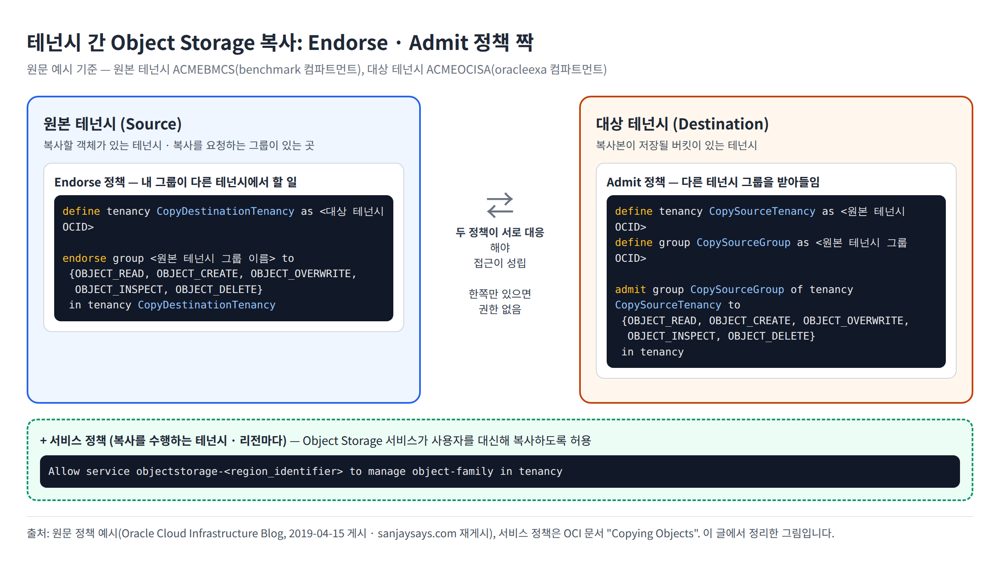
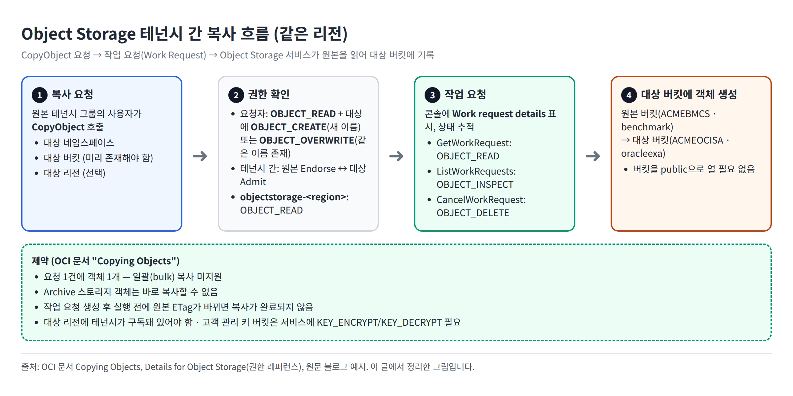

### 들어가며

같은 리전에 테넌시가 두 개 있고, 한 테넌시의 Object Storage에 저장된 데이터를 다른 테넌시로 복사해야 할 때가 있습니다. 원문은 이 경우를 이렇게 설명합니다.

> 버킷을 public으로 만들지 않고 한 테넌시에서 다른 테넌시로 복사하려면 몇 가지 IAM 정책이 추가로 필요합니다.
> ("If you have two tenancies in the same region, and you want to copy data that is stored in Object Storage from one tenancy to the other without making the buckets public, this action requires some additional types of identity and access management (IAM) policies.")

이 글은 원문에 나온 정책을 정리하고, 원문이 언급만 하고 문장을 보여주지 않은 부분(Object Storage 서비스 권한, 복사 API 권한)은 현재 OCI 공식 문서로 보완합니다.

> **원문 정보:** 원문은 2019년 4월 15일 Oracle Cloud Infrastructure Blog에 게시된 글을 저자가 허락을 받아 개인 블로그에 다시 올린 것입니다("My original blog was published in ORACLE CLOUD INFRASTRUCTURE blog site on April 15th, 2019. I have republished it here with permission."). 원문에는 글의 견해가 Oracle의 공식 입장이 아니라는 고지가 붙어 있습니다. 작성 시점이 2019년이므로, 실제 적용 전에는 아래 참고자료의 현재 문서를 함께 확인하세요.

---

### 예시 환경

원문은 다음 환경을 예시로 듭니다.

| 구분 | 테넌시 | 컴파트먼트 |
|---|---|---|
| 원본(Source) | ACMEBMCS | benchmark (Object Storage 버킷 위치) |
| 대상(Destination) | ACMEOCISA | oracleexa |

---

### 복사에 필요한 것

원문은 테넌시 간 복사를 위해 다음이 필요하다고 정리합니다.

1. **Object Storage 서비스 권한:** Object Storage가 원본 버킷과 대상 버킷에 접근할 수 있어야 합니다("Object Storage needs permission to access the source and the destination buckets.").
2. **대상 테넌시 정책:** 복사본을 받는 테넌시에 Admit 정책이 있어야 합니다.
3. **원본 테넌시 정책:** 복사를 보내는 테넌시에 Endorse 정책이 있어야 합니다.

두 테넌시 정책은 짝을 이뤄야 합니다. OCI IAM 문서는 "짝이 되는 문장이 없으면 Endorse나 Admit 문장 하나만으로는 아무 권한도 생기지 않으며, 두 테넌시가 모두 동의해야 한다"고 설명합니다("Without a corresponding statement that specifies access, a particular Endorse or Admit statement grants no access. Both tenancies must agree on access.", [Cross-Tenancy Policies](https://docs.oracle.com/en-us/iaas/Content/Identity/policieshow/iam-cross-domain.htm)).



<small>원문 정책 예시와 OCI 문서 "Copying Objects"를 바탕으로 이 글에서 정리한 그림입니다.</small>

---

### 1단계: 대상 테넌시 정책 (Admit)

복사본이 저장될 테넌시(예시의 ACMEOCISA)에 만듭니다. 원본 테넌시와 그 테넌시의 그룹을 별칭으로 정의하고, 그 그룹을 받아들입니다. 원문 문장은 다음과 같습니다.

```
define tenancy CopySourceTenancy as <ocid_for_source_tenancy>

define group CopySourceGroup as <ocid_for_group_in_source_tenancy>

admit group CopySourceGroup of tenancy CopySourceTenancy to {OBJECT_READ, OBJECT_CREATE, OBJECT_OVERWRITE, OBJECT_INSPECT, OBJECT_DELETE} in tenancy
```

- `<ocid_for_source_tenancy>`: 원본 테넌시 OCID
- `<ocid_for_group_in_source_tenancy>`: 원본 테넌시에 있는 그룹의 **OCID**

### 2단계: 원본 테넌시 정책 (Endorse)

복사할 객체가 있는 테넌시(예시의 ACMEBMCS)에 만듭니다. 대상 테넌시를 별칭으로 정의하고, 자기 테넌시 그룹이 대상 테넌시에서 할 수 있는 일을 정합니다.

```
define tenancy CopyDestinationTenancy as <ocid_for_destination_tenancy>

endorse group <group_name_in_source_tenancy> to {OBJECT_READ, OBJECT_CREATE, OBJECT_OVERWRITE, OBJECT_INSPECT, OBJECT_DELETE} in tenancy CopyDestinationTenancy
```

- `<ocid_for_destination_tenancy>`: 대상 테넌시 OCID
- `<group_name_in_source_tenancy>`: 원본 테넌시에 실제로 있는 그룹의 **이름**

> **주의:** Admit 쪽은 다른 테넌시의 그룹을 `define group ... as <OCID>`로 정의한 **별칭**을 씁니다. Endorse 쪽은 자기 테넌시에 실제로 있는 **그룹 이름**을 씁니다. Endorse에 존재하지 않는 그룹 이름(예: Admit 쪽 별칭)을 적으면 정책 짝이 성립하지 않습니다. 두 문장이 같은 그룹을 가리키도록, Admit의 그룹 OCID와 Endorse의 그룹 이름이 같은 그룹인지 확인하세요.

원문은 이 두 정책을 콘솔에서 만들었다고 설명하고, 원본 테넌시 정책(Source Tenancy Policy)과 대상 테넌시 정책(Target Tenancy Policy) 화면을 캡처로 보여줍니다. 콘솔 정책 생성 방법은 [Creating a Policy](https://docs.oracle.com/en-us/iaas/Content/Identity/policymgmt/managingpolicies_topic-To_create_a_policy.htm) 문서를 참고하세요.

### 3단계: Object Storage 서비스 정책

원문은 "Object Storage가 버킷에 접근할 권한이 필요하다"고만 적고 정책 문장은 보여주지 않습니다. 현재 OCI 문서 [Copying Objects](https://docs.oracle.com/en-us/iaas/Content/Object/Tasks/copyingobjects.htm)는 다음 서비스 정책을 안내합니다.

```
Allow service objectstorage-<region_identifier> to manage object-family in tenancy
```

권한을 좁히려면 문서에 나온 다음 형식을 쓸 수 있습니다.

```
Allow service objectstorage-<region_identifier> to manage object-family in tenancy where any {request.permission='OBJECT_READ', request.permission='OBJECT_INSPECT', request.permission='OBJECT_CREATE', request.permission='OBJECT_OVERWRITE', request.permission='OBJECT_DELETE'}
```

문서는 이 정책에 대해 다음을 명시합니다.

- 서비스에 복사를 위임하지 않으면 객체 복사가 동작하지 않습니다("Object copy doesn't work if you don't authorize the Object Storage service to copy objects on your behalf.").
- Object Storage는 리전 서비스이므로, 복사를 수행하는 **리전마다** 서비스를 허용해야 합니다("you must authorize the Object Storage service for each region carrying out copy operations on your behalf.").

---

### 복사 흐름과 필요한 권한



<small>OCI 문서 Copying Objects, Details for Object Storage와 원문 예시를 바탕으로 이 글에서 정리한 그림입니다.</small>

[Details for Object Storage](https://docs.oracle.com/en-us/iaas/Content/Identity/Reference/objectstoragepolicyreference.htm) 권한 레퍼런스는 `CopyObjectRequest`에 필요한 권한을 이렇게 정리합니다.

| 주체 | 필요한 권한 |
|---|---|
| 요청자 | `OBJECT_READ` |
| 요청자 (대상에 같은 이름 객체가 없을 때) | `OBJECT_CREATE` |
| 요청자 (대상에 같은 이름 객체가 있을 때) | `OBJECT_OVERWRITE` |
| `objectstorage-<location>` 서비스 | `OBJECT_READ` |
| 서비스 (고객 관리 키로 암호화된 버킷) | 추가로 `KEY_ENCRYPT`, `KEY_DECRYPT` |

복사는 작업 요청(work request)으로 처리됩니다. 콘솔에서 복사를 실행하면 **Work request details** 대화상자가 나타나 요청 접수와 진행 상태를 보여줍니다. 작업 요청 관련 권한은 다음과 같습니다.

| 작업 | 필요한 권한 |
|---|---|
| GetWorkRequest | `OBJECT_READ` |
| ListWorkRequests | `OBJECT_INSPECT` |
| CancelWorkRequest | `OBJECT_DELETE` |

원문 정책이 `OBJECT_INSPECT`, `OBJECT_DELETE`까지 포함하는 이유를 원문은 따로 설명하지 않습니다. 위 표처럼 이 권한들은 작업 요청 조회·취소에 쓰입니다.

---

### 추가 테스트 구성: 대상 테넌시 사용자로 원본 객체 읽기 (2026년 11월 9일)

작성자가 제공한 정책 적용 구성입니다. 앞의 원문 예시는 원본 테넌시 그룹이 대상에 접근하는 방식이지만, 이번 구성은 **대상 테넌시 `hermes`의 사용자가 원본 테넌시 `apackrsct`의 객체를 읽는 방식**입니다. Admit·Endorse를 두는 위치는 데이터 이동 방향만으로 결정하지 않고, **어느 테넌시의 사용자가 다른 테넌시 리소스에 접근하는지**를 기준으로 정합니다.

| 구분 | 원본 | 대상 및 실행 사용자 |
|---|---|---|
| 테넌시 | `apackrsct` | `hermes` |
| 리전 | 서울 (`ap-seoul-1`) | 서울 (`ap-seoul-1`) |
| 버킷 | `bucket-20261109-1341` | `bucket-20261109-1342` |
| 사용자 그룹 | 외부 접근을 받아들이는 쪽 | 실제 `Administrators` 그룹 |
| 정책 | 외부 그룹의 원본 읽기를 받아주는 **Admit** | 자기 그룹의 원본 접근을 보증하는 **Endorse**, 대상 서비스 **Allow** |

실제 테넌시·그룹 OCID는 `[ocid]`로 익명화했습니다. 아래 두 `[ocid]`에는 각각 **대상 테넌시 OCID와 대상 Administrators 그룹 OCID**를 넣습니다. 기존 볼륨 테스트의 볼륨 OCID는 Object Storage 정책에 사용하지 않습니다.

#### 원본 apackrsct: 원본 버킷 접근을 받아주는 Admit

```text
Define tenancy CopyDestinationTenancy as [ocid]
Define group HermesCopyGroup as [ocid]
Admit group HermesCopyGroup of tenancy CopyDestinationTenancy to {OBJECT_READ, OBJECT_INSPECT} in compartment CLOUD:CLOUD-HJJANG:KISU.KIM where target.bucket.name = 'bucket-20261109-1341'
```

- `HermesCopyGroup`은 **hermes의 Administrators 그룹 OCID**를 가리키는 별칭입니다. apackrsct의 Administrators 그룹 OCID를 넣지 않습니다.
- `CLOUD:CLOUD-HJJANG:KISU.KIM`은 원본 버킷이 있는 컴파트먼트의 계층 경로입니다. 실제 경로와 버킷 위치가 일치해야 합니다.
- `OBJECT_READ`는 객체 읽기, `OBJECT_INSPECT`는 객체 목록·메타데이터 조회 등에 쓰입니다. 이 문장은 원본 버킷으로 범위를 좁히며 원본 객체의 생성·덮어쓰기·삭제 권한을 부여하지 않습니다.

#### 대상 hermes: 원본 읽기를 보증하는 Endorse와 서비스 Allow

아래 `[ocid]`에는 **원본 apackrsct 테넌시 OCID**를 넣습니다.

```text
Define tenancy CopySourceTenancy as [ocid]
Endorse group Administrators to {OBJECT_READ, OBJECT_INSPECT} in tenancy CopySourceTenancy where target.bucket.name = 'bucket-20261109-1341'
Allow service objectstorage-ap-seoul-1 to manage object-family in tenancy where target.bucket.name = 'bucket-20261109-1342'
```

- `Administrators`는 hermes에 존재하는 **실제 그룹 이름**입니다. 앞선 Admit의 별칭 `HermesCopyGroup`을 자동으로 참조하는 것이 아닙니다. Identity Domain이 구분되는 환경에서는 실제 그룹의 도메인 표기도 확인합니다.
- Endorse와 원본 Admit이 짝을 이뤄 hermes 그룹의 원본 객체 읽기·목록 접근을 허용합니다. 제공된 정책에는 특정 사용자 ID 조건이 없으므로 **해당 그룹 구성원 전체**가 이 권한의 대상입니다.
- Allow의 주체는 사용자 그룹이 아니라 **서울 리전 Object Storage 서비스**입니다. 대상 버킷 이름 조건으로 범위를 제한해 서비스가 복사 작업을 수행하도록 허용하는 문장입니다. 버킷을 공개하거나 PAR을 만드는 정책이 아닙니다.
- 서비스 Allow는 사용자 그룹의 대상 객체 생성·덮어쓰기 권한을 대신하지 않습니다. 실행 사용자에게 대상 버킷의 `OBJECT_CREATE` 또는 기존 객체를 덮어쓸 경우 `OBJECT_OVERWRITE` 권한이 있는지 별도로 확인해야 합니다. 또한 Object Storage 서비스가 원본 객체를 읽을 수 있는 권한도 확인해야 합니다. 위 세 문장만으로 모든 환경의 복사가 완료된다고 보장하지 않습니다.

권한과 서비스 위임 설명의 근거: [Object Storage 권한 레퍼런스](https://docs.oracle.com/en-us/iaas/Content/Identity/Reference/objectstoragepolicyreference.htm), [객체 복사와 서비스 권한](https://docs.oracle.com/en-us/iaas/Content/Object/Tasks/copyingobjects.htm).

#### 테스트 확인 범위

작성자는 **이 정책이 적용되는 구성에서 테스트 가능**하다고 전달했습니다. 이번에 제공된 자료는 정책 문장이며, 복사 명령 응답·작업 요청 완료·대상 객체 비교 결과는 포함되지 않았습니다. 따라서 **정책 구성 사례**로 기록하고 다음 항목은 테스트 결과로 별도 확인합니다.

1. hermes 사용자로 원본 네임스페이스·버킷의 객체 목록과 읽기 접근 확인
2. 대상 버킷에 대한 사용자 쓰기 권한과 서비스 권한 확인
3. 기존 객체 덮어쓰기 여부를 정한 뒤 테스트 객체 복사 요청
4. 작업 요청 완료 및 대상 객체 이름·크기·내용 확인

원본·대상 네임스페이스는 각 테넌시의 실제 조회 결과를 사용하며 테넌시 이름으로 추정하지 않습니다. 이번 문서 업데이트에서는 OCI 접속·정책 변경·객체 복사를 실행하지 않았습니다.

---

### CLI로 복사하기

원문에는 CLI 명령이 없습니다. 아래는 [Copying Objects](https://docs.oracle.com/en-us/iaas/Content/Object/Tasks/copyingobjects.htm) 문서의 형식입니다.

```bash
oci os object copy --bucket-name source_bucket_name --source-object-name source_object_name --destination-bucket destination_bucket_name [OPTIONS]
```

문서 예시:

```bash
oci os object copy --bucket-name photos --source-object-name hummingbird.jpg --destination-namespace ansh8lvru1zp --destination-bucket UK_photos
```

다른 테넌시로 복사할 때는 `--destination-namespace`에 **대상 테넌시의 네임스페이스**를 지정합니다. 문서에 나온 주요 옵션은 다음과 같습니다.

| 옵션 | 설명 |
|---|---|
| `--bucket-name`, `--source-object-name` | 원본 버킷과 원본 객체 |
| `--destination-bucket` | 대상 버킷. 미리 만들어져 있어야 합니다 |
| `--destination-namespace` | 대상 네임스페이스. 콘솔에서는 자기 테넌시 네임스페이스가 기본값입니다 |
| `--destination-region` | 대상 리전 (예: `uk-london-1`) |
| `--destination-object-name` | 대상 객체 이름을 바꿀 때 |
| `--destination-object-storage-tier` | `Standard`, `InfrequentAccess`, `Archive` |

---

### 버킷 전체 복사하기

[Copying Objects](https://docs.oracle.com/en-us/iaas/Content/Object/Tasks/copyingobjects.htm) 문서는 일괄 복사를 지원하지 않는다고 명시합니다("Bulk copying isn't supported. Identify a single object in the copy request."). 버킷 전체를 옮기려면 **객체 목록을 조회한 뒤 객체마다 `oci os object copy`를 호출**해야 합니다. 아래는 그 과정을 반복문으로 묶은 예시입니다(이 글에서 작성한 스크립트이며, `jq`가 필요합니다).

```bash
#!/usr/bin/env bash
# 원본 버킷의 모든 객체를 대상 버킷으로 복사
set -u
PROFILE=<CLI 프로파일>
REGION=ap-seoul-1
SRC_NS=<원본 테넌시 네임스페이스>
SRC_BUCKET=<원본 버킷>
DST_NS=<대상 테넌시 네임스페이스>
DST_BUCKET=<대상 버킷>

oci os object list --profile "$PROFILE" --region "$REGION" \
  --namespace "$SRC_NS" --bucket-name "$SRC_BUCKET" --all \
  --query 'data[].name' --raw-output | jq -r '.[]' |
while IFS= read -r OBJ; do
  echo "copy: $OBJ"
  oci os object copy --profile "$PROFILE" --region "$REGION" \
    --namespace "$SRC_NS" --bucket-name "$SRC_BUCKET" \
    --source-object-name "$OBJ" \
    --destination-namespace "$DST_NS" --destination-bucket "$DST_BUCKET" \
    --destination-object-name "$OBJ" \
    || echo "FAILED: $OBJ" >> copy-failed.txt
done
```

- 특정 경로만 옮기려면 `oci os object list`에 `--prefix "<접두어>/"`를 추가합니다.
- 실패한 객체 이름은 `copy-failed.txt`에 남으므로 그 목록만 다시 실행할 수 있습니다.
- `--profile`에는 Endorse·Admit 정책으로 허용된 사용자의 프로파일을 지정합니다.

#### 복사 결과 확인

복사는 작업 요청(work request)으로 처리되므로, `copy` 명령이 성공했다는 것은 **요청이 접수됐다**는 뜻입니다. 진행 상태와 결과는 따로 확인합니다.

```bash
# 작업 요청 상태 조회
oci os work-request list --profile "$PROFILE" --region "$REGION" --compartment-id <구획 OCID>

# 원본·대상 객체 개수 비교
oci os object list --profile "$PROFILE" --region "$REGION" --namespace "$SRC_NS" --bucket-name "$SRC_BUCKET" --all --query 'length(data)'
oci os object list --profile "$PROFILE" --region "$REGION" --namespace "$DST_NS" --bucket-name "$DST_BUCKET" --all --query 'length(data)'
```

목록 조회(`ListObjects`)에는 `OBJECT_INSPECT`, 작업 요청 조회에는 `OBJECT_READ`(GetWorkRequest)·`OBJECT_INSPECT`(ListWorkRequests)가 필요합니다([Details for Object Storage](https://docs.oracle.com/en-us/iaas/Content/Identity/Reference/objectstoragepolicyreference.htm)). 대상 버킷에 같은 이름의 객체가 있으면 `OBJECT_OVERWRITE` 권한으로 덮어쓰게 되므로, 실행 전에 대상 버킷을 확인하세요.

---

### 제약 사항

[Copying Objects](https://docs.oracle.com/en-us/iaas/Content/Object/Tasks/copyingobjects.htm) 문서에 나온 제약입니다.

- **한 번에 객체 하나:** 일괄(bulk) 복사는 지원하지 않습니다. 요청마다 객체 하나를 지정합니다("Bulk copying isn't supported. Identify a single object in the copy request.").
- **Archive 객체:** Archive Storage의 객체는 바로 복사할 수 없습니다.
- **ETag 변경:** 작업 요청이 만들어진 뒤 실행되기 전에 원본 객체의 ETag가 바뀌면 복사가 완료되지 않습니다.
- **리전 구독:** 객체를 복사하려는 리전을 테넌시가 구독하고 있어야 합니다("Your tenancy must be subscribed to a region for you to copy an object to a bucket in that region.").

---

### 원문을 읽을 때 확인할 점

- **복사를 시작하는 주체:** 원문은 "대상 테넌시의 인스턴스 프린시펄이 복사를 시작한다"("The instance principal from the destination tenancy initiates the copy process.")고 적습니다. 그런데 원문의 정책은 **원본 테넌시 그룹**을 Endorse하고 대상 테넌시가 그 그룹을 Admit하는 구조이며, 인스턴스 프린시펄(동적 그룹)에 대한 정책 문장은 없습니다. 원문은 이 둘의 관계를 설명하지 않으므로, 실제 구성할 때는 요청 주체가 어느 테넌시의 어떤 그룹(또는 동적 그룹)인지 정하고 그 주체를 기준으로 Endorse·Admit을 맞추세요.
- **리전 간 복사:** 원문은 같은 리전 예시이며, 리전 간 복사도 "기본적으로 같은 IAM 정책과 권한을 쓸 수 있다"("you can essentially use the same IAM policies and permissions")고 적습니다. 이때도 위 서비스 정책은 복사를 수행하는 리전마다 필요하고, 테넌시가 대상 리전을 구독하고 있어야 합니다.
- **같은 리전 구독:** OCI IAM 문서는 테넌시 간 리소스 공유에 두 테넌시가 같은 리전을 구독하고 있어야 한다고 설명합니다("target and source tenancies must subscribe to the same regions to share resources", [Cross-Tenancy Policies](https://docs.oracle.com/en-us/iaas/Content/Identity/policieshow/iam-cross-domain.htm)).

---

### 마무리

| 항목 | 위치 | 내용 |
|---|---|---|
| Endorse 정책 | 원본 테넌시 | 자기 그룹(실제 그룹 이름)이 대상 테넌시에서 `OBJECT_*` 권한을 쓰도록 허용 |
| Admit 정책 | 대상 테넌시 | 원본 테넌시 그룹(OCID 별칭)을 받아들임 |
| 서비스 정책 | 복사를 수행하는 리전마다 | `objectstorage-<region>`에 `object-family` 권한 위임 |
| 복사 실행 | 콘솔 또는 `oci os object copy` | 대상 네임스페이스·버킷 지정, 작업 요청으로 진행 상태 확인 |

버킷을 public으로 열지 않고도 정책만으로 테넌시 사이에 객체를 옮길 수 있습니다. 다만 요청 1건에 객체 1개라는 제약이 있으므로, 객체가 많다면 이 블로그의 rclone 시리즈처럼 별도 도구를 함께 검토할 수 있습니다.

---

### 참고자료

- [OCI Object Storage: Copy Objects Across Tenancies Within a Region (원문, sanjaysays.com)](https://www.sanjaysays.com/2019/08/oci-object-storage-copy-objects-across.html)
- [Copying Objects (OCI 문서)](https://docs.oracle.com/en-us/iaas/Content/Object/Tasks/copyingobjects.htm)
- [Details for Object Storage (정책 레퍼런스)](https://docs.oracle.com/en-us/iaas/Content/Identity/Reference/objectstoragepolicyreference.htm)
- [Cross-Tenancy Policies](https://docs.oracle.com/en-us/iaas/Content/Identity/policieshow/iam-cross-domain.htm)
- [Creating a Policy](https://docs.oracle.com/en-us/iaas/Content/Identity/policymgmt/managingpolicies_topic-To_create_a_policy.htm)
